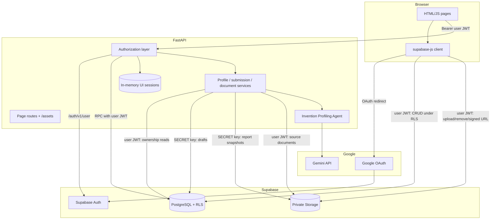
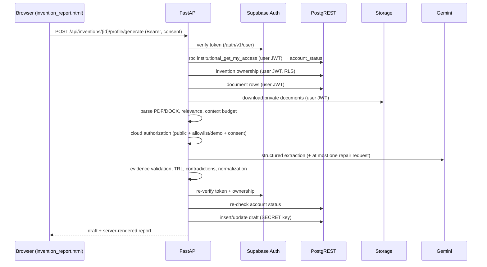
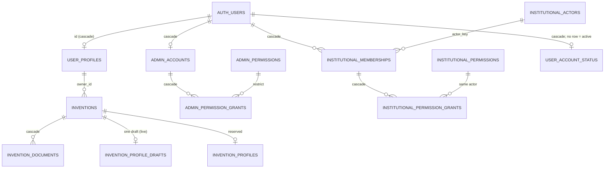

# Profile Match — Technical Documentation and Development Handoff

**AI Industry Partner & Licensee Matching Agent**

This file is the central technical reference for the project. It describes the
implementation **as it exists in the repository**, the deployed Supabase
configuration **as far as it has been reported and verified**, and the approved
roadmap. It is written so that a developer or AI coding assistant can continue
the project without any previous conversation history.

> Conventions used throughout
> - **Implemented** = code exists in this repository.
> - **Deployed (reported)** = applied to Supabase by the project owner; not
>   verifiable from the repository alone.
> - **Proposed / Planned** = design only; nothing exists yet.
> - "Verified (simulated)" = automated tests against mocked Supabase/Gemini.
>   "Verified (live)" = confirmed by the project owner against real Google,
>   Supabase or Gemini.
> - No credentials, keys, tokens or environment values appear in this file.

`README.md` is an older, partly outdated status note (it still mentions the
retired local Qwen model). It has deliberately not been changed; this file
supersedes it.

---

## Table of contents

1. [Project overview](#1-project-overview)
2. [Technology stack](#2-technology-stack)
3. [Directory structure](#3-directory-structure)
4. [System architecture](#4-system-architecture)
5. [Supabase database structure](#5-supabase-database-structure)
6. [Supabase Storage architecture](#6-supabase-storage-architecture)
7. [Authentication architecture](#7-authentication-architecture)
8. [Actor and role architecture](#8-actor-and-role-architecture)
9. [RBAC permission registry](#9-rbac-permission-registry)
10. [Role Switcher and protected interfaces](#10-role-switcher-and-protected-interfaces)
11. [Global account security](#11-global-account-security)
12. [Database functions and triggers](#12-database-functions-and-triggers)
13. [API endpoint inventory](#13-api-endpoint-inventory)
14. [Innovator module](#14-innovator-module)
15. [Invention Profiling Agent](#15-invention-profiling-agent)
16. [Multi-agent architecture](#16-multi-agent-architecture)
17. [Planned Data Collection Agent](#17-planned-data-collection-agent)
18. [AI model routing plan](#18-ai-model-routing-plan)
19. [Matching and commercialization workflow](#19-matching-and-commercialization-workflow)
20. [Development phase history](#20-development-phase-history)
21. [Future roadmap](#21-future-roadmap)
22. [Testing and verification](#22-testing-and-verification)
23. [Setup and development](#23-setup-and-development)
24. [Database migration history](#24-database-migration-history)
25. [GitHub checkpoints](#25-github-checkpoints)
26. [Known limitations and technical debt](#26-known-limitations-and-technical-debt)
27. [Development rules for AI assistants](#27-development-rules-for-ai-assistants)
28. [Phase 5.5.1 — User Management database foundation](#28-phase-551--user-management-database-foundation)
29. [Current development handoff](#29-current-development-handoff)

---

## 1. Project overview

### Problem

University and institutional research produces inventions that rarely reach
industry. Technology-transfer staff must read long technical documents, judge
readiness, find suitable companies or licensees, and run outreach — mostly by
hand. Good matches are missed and verified information is scattered.

### Objectives

- Let innovators register inventions and upload their research documents.
- Turn those documents into a structured, **evidence-backed** invention profile
  with AI assistance, which the innovator reviews and edits (human in the loop).
- Let institutional staff (Innovation Center) verify profiles.
- Build verified profiles of candidate industry partners from authorized public
  sources (future Data Collection Agent).
- Match inventions to partners with explainable scoring, then support approved
  outreach and engagement tracking.

### Intended users

| User | Role in the workflow |
|---|---|
| Innovator / Researcher | Registers inventions, uploads documents, generates/edits/submits profiles |
| Innovation Center (Head/Employee) | Reviews and verifies invention profiles, portfolio, matches |
| Industry Liaison (Head/Employee) | Partner outreach and engagement (future) |
| Management (Head/Employee) | KPIs, reports, analytics (future) |
| Administrator / Admin Employee | Users, roles, organizations, data sources, agents, audit |
| Industry Partner / Licensee | External party (architecture only; not onboarded) |

### Commercialization workflow (target)

```mermaid
flowchart LR
  A[Innovator registers invention] --> B[Uploads documents]
  B --> C[AI Invention Profile draft]
  C --> D[Innovator edits & submits]
  D --> E[Innovation Center verification]
  E --> F[Matching & scoring vs approved organization profiles]
  F --> G[Explanation + risk review]
  G --> H[Institutional approval]
  H --> I[Outreach drafting & approval]
  I --> J[Engagement tracking]
  J --> K[Learning / feedback]
```



Steps A–D are implemented. E has a protected **demonstration** interface with
fictional data only. F–K are planned.

### Current scope (implemented)

Google sign-in, Innovator dashboard, invention registration/editing/deletion,
private document upload, document parsing, Gemini-based Invention Profiling
Agent, editable persistent drafts, versioned JSON/DOCX submissions, Administrator
UI preview with server-side authorization, unified institutional RBAC, protected
Innovation Center demo interface, server-controlled Role Switcher, session
hardening and application-wide account restriction enforcement.

### Future scope

User and Employee Management, organization (company) registration, Data
Collection Agent, model routing, organization profile approval/versioning,
weekly scans, matching, explanation, risk, outreach, engagement and learning
agents, Industry Partner onboarding.

---

## 2. Technology stack

| Component | Technology (verified in repository) |
|---|---|
| Frontend | HTML, CSS, vanilla JavaScript (no framework, no build step) |
| Backend | Python, FastAPI 0.165, Starlette 1.10, Uvicorn 0.54 |
| Python runtime | Python 3.14 (virtual environment `backend/.venv`) |
| Database | Supabase PostgreSQL |
| Authentication | Supabase Auth |
| Login provider | Google OAuth (via Supabase) |
| File storage | Supabase private Storage |
| Browser SDK | `@supabase/supabase-js@2` from jsDelivr CDN |
| Backend HTTP | `httpx` 0.28 (direct REST calls to Supabase Auth, PostgREST and Storage) |
| AI integration | Google Gemini API via `google-genai` 3.6.1 |
| Default AI model | `gemini-3.5-flash-lite` (`backend/app/services/gemini_client.py`) |
| Data validation | Pydantic 2.14 |
| Document parsing | PyMuPDF / `pymupdf4llm` (PDF), `python-docx` (DOCX) |
| Report formats | JSON and DOCX (`python-docx`) |
| Tests | Python `unittest`; Node.js and headless Chrome/Edge for frontend checks |
| Version control | Git, GitHub |

**Dependency note:** `backend/requirements.txt` lists only `fastapi`,
`uvicorn[standard]`, `supabase`, `python-dotenv`, `python-multipart` and
`google-genai`. The installed environment additionally uses `httpx`,
`pydantic`, `pymupdf`, `pymupdf4llm` and `python-docx`, which are **not pinned in
requirements.txt** (technical debt, §26). The `supabase` Python package is
listed but the backend talks to Supabase with `httpx` directly.

**Model history:** Phases 1–3 planned a local **Qwen 3.5 9B via Ollama**
profiling model (still mentioned in `README.md`). It was replaced by the Gemini
API during Phase 4. **Qwen/Ollama are not active components**; tests assert
that no Ollama/Qwen references remain in user-facing output.

---

## 3. Directory structure

Virtual environments, caches and generated artifacts are omitted.

```text
profile_match/
├── read.md                         ← this file
├── README.md                       ← legacy status note (outdated, kept)
├── .env                            ← local secrets (git-ignored; never commit)
├── .gitignore                      ← ignores .env*, .venv, __pycache__, *.pyc, logs
├── backend/
│   ├── requirements.txt            ← incomplete dependency list (see §2)
│   └── app/
│       ├── main.py                 ← FastAPI app, routers, /assets mount, page routes, document-parse route
│       ├── config.py               ← loads .env: SUPABASE_URL, SUPABASE_PUBLISHABLE_KEY
│       ├── agents/
│       │   └── profiling_agent.py  ← Invention Profiling Agent (Gemini, evidence validation)
│       ├── api/
│       │   ├── profiles.py             ← draft get/save, generate, regenerate
│       │   ├── profile_submissions.py  ← submit, list, download submissions
│       │   ├── admin_access.py         ← GET /api/admin/access/me
│       │   ├── admin_ui.py             ← protected /admin UI + Administrator UI session
│       │   ├── institutional_access.py ← GET /api/access/me
│       │   ├── institutional_ui.py     ← protected /institutional UI + institutional UI session
│       │   ├── auth.py, documents.py, inventions.py   ← EMPTY placeholders (unused)
│       ├── core/
│       │   ├── account_status.py       ← active-account dependency for Innovator APIs
│       │   ├── admin_access.py         ← Bearer extraction + Administrator dependencies
│       │   ├── admin_permissions.py    ← 24 administrative permissions, roles, statuses
│       │   ├── admin_pages.py          ← Administrator page/asset allowlist + page permissions
│       │   ├── admin_static.py         ← ProtectedStaticFiles (blocks protected paths on /assets)
│       │   ├── admin_ui_session.py     ← in-memory opaque UI session store (shared class)
│       │   ├── institutional_access.py ← institutional dependencies (require_actor, …)
│       │   ├── institutional_pages.py  ← Innovation Center file allowlist + page permissions
│       │   ├── institutional_permissions.py ← 28 institutional permissions, Head-only rules
│       │   ├── institutional_roles.py  ← actors, positions, statuses, interface list
│       │   ├── dependencies.py, security.py ← EMPTY placeholders (unused)
│       ├── repositories/
│       │   ├── supabase_client.py      ← small legacy helper (not used by current routes)
│       │   └── *_repository.py         ← EMPTY placeholders (unused)
│       ├── schemas/
│       │   ├── profile.py              ← InventionAIProfile (Pydantic) — the profile schema
│       │   ├── admin_access.py         ← /api/admin/access/me response model
│       │   ├── institutional_access.py ← /api/access/me response model
│       │   └── document.py, invention.py, user.py ← EMPTY placeholders
│       └── services/
│           ├── admin_access_service.py     ← Administrator access + SHARED account-record parser
│           ├── institutional_access_service.py ← unified institutional access
│           ├── cloud_authorization.py      ← when documents may be sent to Gemini (allowlist/demo)
│           ├── document_parser.py          ← PDF/DOCX text extraction with limits
│           ├── document_processor.py       ← verify_user, ownership, private download, parsing
│           ├── gemini_client.py            ← Gemini client, free-tier quota guard, retries
│           ├── profile_service.py          ← drafts (secret-key writes after checks)
│           ├── profile_submission_service.py ← JSON/DOCX snapshots in invention-profiles
│           ├── report_docx.py              ← DOCX builder
│           ├── report_renderer.py          ← shared report rendering (web + DOCX)
│           └── validation_service.py       ← EMPTY placeholder
├── frontend/
│   ├── index.html                  ← Innovator dashboard (/dashboard)
│   ├── login.html                  ← Google sign-in (/login)
│   ├── invention_report.html       ← AI report: generate, edit, autosave, submit, download
│   ├── phase4_test.html            ← DEVELOPMENT-ONLY test page (blocked from public serving)
│   ├── css/style.css, css/roles.css
│   ├── js/
│   │   ├── api.js                  ← window.getSupabase() (config from /api/config/public)
│   │   ├── auth.js                 ← Google OAuth sign-in, existing-session redirect
│   │   ├── dashboard.js            ← dashboard, account gate, sign-out
│   │   ├── register.js             ← invention registration/editing (direct Supabase)
│   │   ├── upload.js               ← document upload (direct Supabase Storage)
│   │   ├── role-switcher.js        ← server-driven interface switcher, UI session helpers
│   │   ├── session-header.js       ← account name + sign-out on role pages
│   │   └── app.js, profile.js      ← EMPTY placeholders
│   └── roles/                      ← ALL blocked on /assets; served only via protected routes
│       ├── administrator/          ← Administrator UI (10 pages, css/admin.css, js/*.js) → /admin/*
│       ├── innovation-center/      ← IC demo UI (fictional data) → /institutional/innovation-center/*
│       ├── industry-liaison/index.html  ← coming-soon placeholder (never served)
│       ├── management/index.html        ← coming-soon placeholder (never served)
│       └── industry-partner/index.html  ← coming-soon placeholder (never served)
├── supabase/
│   ├── migrations/
│   │   ├── 001_initial_schema.sql  ← original schema (does NOT match deployed DB fully)
│   │   ├── 002_phase3_registration.sql ← EMPTY file
│   │   ├── 003_admin_access.sql    ← applied (Phase 5.2.2) — recovered original
│   │   ├── 004_institutional_access.sql ← applied (Phase 5.3.2) — recovered original
│   │   ├── 005_global_account_security.sql ← applied (Phase 5.4.3B) — recovered original
│   │   ├── 006_user_directory.sql  ← Phase 5.5.1 DRAFT: read-only user directory (not applied)
│   │   └── 007_administrator_invariant_and_audit.sql ← Phase 5.5.1 DRAFT: last-Administrator invariant + admin audit (not applied)
│   ├── policies/storage_policies.sql ← early storage policy draft
│   └── seed/demo_users.py          ← EMPTY placeholder (no seeded users by design)
└── tests/                          ← see §22
    ├── _fixtures.py, _large_fixture.py, _rainlattice_fixture.py, innovation_center_samples.py
    ├── test_*.py (15 files)
    └── e2e_live/                   ← manual live-test kit (CHECKLIST.md, make_documents.py, verify_downloads.py)
```

Migrations 003, 004 and 005 were applied in Supabase by the project owner. The
original SQL files were recovered from the owner's Downloads folder on
2026-11-28 and copied unchanged (SHA-256 verified) into `supabase/migrations/`
(§24). They have **not** been executed again.

---

## 4. System architecture



### Operation classes

| Class | Examples | Credential | Protection |
|---|---|---|---|
| Direct browser → Supabase | list/register/edit/delete inventions, insert document rows, upload/remove files, signed download URLs, read drafts, read own profile | publishable key + user JWT | RLS ownership policies **AND** restrictive account-status policies |
| FastAPI-controlled (user context) | identity verification, ownership checks, source-document download for parsing | publishable key + user JWT | Bearer verification, active-account check, RLS |
| Server-only secret-key | insert/update `invention_profile_drafts`; upload/list/download/delete in `invention-profiles` | `SUPABASE_SECRET_KEY` (never sent to browser) | only after authentication, account-status and ownership checks |
| AI requests | Gemini generate (profiling only) | `GEMINI_API_KEY` (server only) | cloud-processing authorization (public invention + allowlist/demo + consent) |
| Authorization RPCs | `admin_get_my_access()`, `institutional_get_my_access()` | user JWT | SECURITY DEFINER self-lookup keyed on `auth.uid()` |

### Profile generation data flow



---

## 5. Supabase database structure

**Accuracy notice.** Sources, in decreasing certainty:

1. **Applied migration files 003, 004, 005** (recovered originals) — exact DDL
   for the administrative, institutional, account-status and audit objects and
   the six restrictive policies. "Verified (applied SQL)" below.
2. **Migration 005's preflight**, which lists by name the permissive
   ownership policies that existed in the live database when 005 was applied
   (it aborts if any is missing) — so those policies are confirmed to exist.
3. **`001_initial_schema.sql`** — original Innovator schema; later changes
   (drafts table, delete policies, `handle_new_innovator`) were applied without
   a migration file.
4. **Live inspection (Phase 5.5.1, run by the owner)** — five read-only
   queries (columns, constraints, triggers, security counts, function list).
   Results were reported to the assistant as verified findings; the raw
   result sets are not stored in the repository. "Verified live" below.

Verified live summary: 14 public tables, 18 public functions, 18 inspected
triggers (all enabled), 1 globally active Administrator, 0 Admin Employees,
0 institutional memberships, 0 restricted accounts, 24 administrative and 28
institutional permission keys. Items still marked *(live verification
required)* were not covered by the reported findings.

### 5.1 Table overview

| Table | Purpose | Source of definition | Used by app now |
|---|---|---|---|
| `auth.users` | Supabase identities (Google) | Supabase | yes |
| `public.user_profiles` | Innovator name, department, legacy `role` | 001 (+ trigger, live) | yes (name only) |
| `public.inventions` | Registered inventions | 001 | yes |
| `public.invention_documents` | Uploaded document metadata | 001 | yes |
| `public.invention_profile_drafts` | Editable AI drafts | no DDL file (policies confirmed by 005 preflight) | yes |
| `public.invention_profiles` | "Approved" profile (original design) | 001 | **reserved** (not written by current code) |
| `public.admin_accounts` | Administrative role + status | 003 (verified, applied SQL) | yes |
| `public.admin_permissions` | 24-key catalogue | 003 (verified) | indirectly |
| `public.admin_permission_grants` | Admin Employee grants | 003 (verified) | yes |
| `public.institutional_actors` | 4 actors | 004 (verified) | indirectly |
| `public.institutional_permissions` | 28-key catalogue | 004 (verified) | indirectly |
| `public.institutional_memberships` | Head/Employee memberships | 004 (verified) | yes |
| `public.institutional_permission_grants` | Employee grants | 004 (verified) | yes |
| `public.user_account_status` | Global restrictions (no row = active) | 004 (verified) | yes |
| `public.audit_logs` | Append-only access-change audit | 004 (verified) | written by triggers only |

### 5.2 Innovator tables (001 + verified live)

**`auth.users`** (verified live, columns used by the application): `id` uuid
(primary identity), `email` varchar **nullable**, `created_at` timestamptz
**nullable**, `last_sign_in_at` timestamptz **nullable**. Never exposed to
clients directly.

**`public.user_profiles`** (verified live)

| Column | Type | Constraints / default |
|---|---|---|
| id | uuid | PK, FK → `auth.users(id)` ON DELETE CASCADE (verified) |
| full_name | text | NOT NULL |
| department | text | nullable |
| role | text | NOT NULL DEFAULT `'innovator'` (001 CHECK list) |
| created_at | timestamptz | DEFAULT now() |

RLS enabled; policy "Read own user profile" (+ restrictive). Rows are created
by trigger **`on_new_innovator_created`** on `auth.users`, which runs
`handle_new_innovator()` (verified live; no migration file; **do not change**).
**`role` is legacy and never used for authorization** (§7).

**`public.inventions`**

| Column | Type | Constraints / default |
|---|---|---|
| id | UUID | PK DEFAULT gen_random_uuid() |
| owner_id | UUID | NOT NULL, FK → `user_profiles(id)` **without CASCADE** (verified live) |
| title | TEXT | NOT NULL |
| abstract, domain, ip_status | TEXT | |
| trl | SMALLINT | CHECK 1–9 |
| inventors, keywords | TEXT[] | DEFAULT '{}' |
| confidentiality | TEXT | NOT NULL DEFAULT 'restricted', CHECK in (public, restricted, confidential) |
| status | TEXT | NOT NULL DEFAULT 'draft', CHECK in (draft, processing, awaiting_review, approved) |
| created_at, updated_at | TIMESTAMPTZ | DEFAULT NOW(); trigger `inventions_updated_at` |

Permissive policies confirmed present by 005's preflight (all `TO
authenticated`): "Read own inventions" (SELECT), "Create own inventions"
(INSERT), "Update own inventions" (UPDATE), **"Delete own inventions"
(DELETE)** — the delete policy is not in 001, so its exact condition is
*(live verification required)*. Plus the restrictive
`pm_active_account_required` (005). Note: test fixtures use a `registered`
status value that 001's CHECK does not list — the deployed constraint may
differ *(live verification required)*.

**`public.invention_documents`** — id UUID PK; invention_id FK → inventions ON
DELETE CASCADE; original_filename TEXT NOT NULL; storage_path TEXT NOT NULL
UNIQUE; mime_type TEXT; file_size BIGINT; uploaded_at TIMESTAMPTZ. Confirmed
policies: "Read own documents" (SELECT), "Add own documents" (INSERT), plus
restrictive `pm_active_account_required`. **No DELETE policy was listed** —
document rows are removed through the `ON DELETE CASCADE` from `inventions`
*(live verification required that no other delete policy exists)*.

**`public.invention_profiles`** — id; invention_id UNIQUE FK → inventions
CASCADE (verified live); ai_extracted_data JSONB; approved_data JSONB;
approved_by FK → user_profiles **without CASCADE** (verified live); revision
INT ≥ 1; approved_at, updated_at. **Reserved**: the current workflow stores
drafts in `invention_profile_drafts` and submissions in Storage; nothing writes
this table today.

**`public.invention_profile_drafts`** (verified live; no migration file — **do
not modify**)

| Column | Type | Constraints / default |
|---|---|---|
| id | uuid | PK DEFAULT gen_random_uuid() |
| invention_id | uuid | NOT NULL, **UNIQUE** (one draft per invention), FK → inventions(id) ON DELETE CASCADE |
| ai_generated_data | jsonb | NOT NULL, CHECK is a JSON object |
| edited_data | jsonb | NOT NULL, CHECK is a JSON object |
| generation_number | integer | NOT NULL DEFAULT 1, CHECK ≥ 1 |
| created_at | timestamptz | NOT NULL DEFAULT now() |
| updated_at | timestamptz | NOT NULL DEFAULT now(); trigger `trg_invention_profile_drafts_updated_at` (BEFORE UPDATE → `set_invention_profile_drafts_updated_at()`) |

Policies (005 preflight): "Create own invention profile drafts" (INSERT), "Read
own invention profile drafts" (SELECT), "Update own invention profile drafts"
(UPDATE), plus restrictive `pm_active_account_required`. The backend writes
drafts with the secret key (bypasses RLS) after its own checks; `updated_at`
drives optimistic concurrency.

`invention_profiles` confirmed policies: "Create own invention profiles",
"Read own invention profiles", "Update own invention profiles" (+ restrictive).
`user_profiles`: "Read own user profile" (+ restrictive).
005 also revoked TRUNCATE, TRIGGER and REFERENCES on the five Innovator tables
from PUBLIC, anon and authenticated.

### 5.3 Administrative tables (migration 003 — verified, applied SQL)

**`admin_permissions`**

| Column | Type | Constraints |
|---|---|---|
| key | text | PK; CHECK `key ~ '^[a-z]+(\.[a-z_]+)+$'` |
| description | text | NOT NULL |
| administrator_only | boolean | NOT NULL DEFAULT false |

Seeded with the 24 keys of §9 (9 Administrator-only).

**`admin_accounts`**

| Column | Type | Constraints |
|---|---|---|
| user_id | uuid | PK; FK → auth.users(id) ON DELETE CASCADE |
| role | text | NOT NULL; CHECK in (administrator, admin_employee) |
| status | text | NOT NULL DEFAULT 'active'; CHECK in (active, suspended, banned) |
| status_reason | text | CHECK length ≤ 1000 |
| status_changed_at | timestamptz | set by guard on status change |
| created_at | timestamptz | NOT NULL DEFAULT now() |
| created_by | uuid | FK → auth.users(id) ON DELETE SET NULL |
| updated_at | timestamptz | NOT NULL DEFAULT now(); set by guard on UPDATE |
| updated_by | uuid | FK → auth.users(id) ON DELETE SET NULL |

CHECKs `admin_accounts_not_self_created`, `admin_accounts_not_self_updated`.
Indexes: (role, status), created_by, updated_by.

**`admin_permission_grants`**

| Column | Type | Constraints |
|---|---|---|
| user_id | uuid | PK part; FK → admin_accounts(user_id) ON DELETE CASCADE |
| permission_key | text | PK part; FK → admin_permissions(key) ON UPDATE CASCADE ON DELETE RESTRICT |
| granted_by | uuid | FK → auth.users(id) ON DELETE SET NULL |
| granted_at | timestamptz | NOT NULL DEFAULT now() |

CHECK `admin_permission_grants_not_self_granted`. Indexes: permission_key,
granted_by.

Security: RLS enabled, **no policies**; ALL privileges revoked from PUBLIC,
anon, authenticated **and service_role** (the backend secret key cannot read or
write these tables either). Clients read only through `admin_get_my_access()`.

### 5.4 Institutional, account-status and audit tables (migration 004 — verified, applied SQL)

| Table | Columns (type) | Keys and constraints |
|---|---|---|
| `institutional_actors` | key text, label text, accepts_memberships boolean (default false) | PK key; CHECK `^[a-z_]+$`. Seeded: innovation_center, industry_liaison, management (accept memberships), industry_partner (does not) |
| `institutional_permissions` | key text, actor_key text, description text, head_only boolean (default false) | PK key; FK actor_key → institutional_actors; CHECK prefix = actor; UNIQUE (key, actor_key). 28 rows |
| `user_account_status` | user_id uuid, status text, reason text, changed_at timestamptz (default now()), changed_by uuid | PK user_id FK → auth.users ON DELETE CASCADE; status CHECK (active, suspended, banned); reason ≤ 1000; CHECK not self. **changed_by has no FK.** Partial index on non-active status |
| `institutional_memberships` | user_id uuid, actor_key text, position text, status text (default active), status_reason text, created_at, created_by uuid, updated_at, updated_by uuid | PK (user_id, actor_key); user_id FK → auth.users ON DELETE CASCADE; actor_key FK; position CHECK (head, employee); status CHECK (active, suspended, revoked); no-self CHECKs. **created_by/updated_by have no FK** |
| `institutional_permission_grants` | user_id uuid, actor_key text, permission_key text, granted_by uuid, granted_at timestamptz | PK (user_id, permission_key); FK (user_id, actor_key) → memberships ON DELETE CASCADE; FK (permission_key, actor_key) → permissions(key, actor_key) ON DELETE RESTRICT (cross-actor grants impossible); CHECK not self. **granted_by has no FK** |
| `audit_logs` | id bigint identity, occurred_at, actor_user_id uuid, actor_role text, action text, entity_type text, entity_id text, target_user_id uuid, result text (default succeeded), details jsonb (default {}) | PK id; result CHECK (succeeded, failed, denied); length CHECKs; **no FKs** (history survives deletion); indexes on occurred_at, target, actor, action |

Security: RLS enabled with no policies on all six; ALL table privileges and the
`audit_logs_id_seq` sequence revoked from PUBLIC, anon, authenticated and
service_role.

### 5.5 Relationships



`audit_logs` deliberately has no foreign keys.

---

## 6. Supabase Storage architecture

### Bucket `invention-document` (deployed)

| Property | Value |
|---|---|
| Visibility | private |
| Max file size | 20 MB (also enforced in `upload.js` and `document_processor.py`) |
| Formats | PDF, DOC, DOCX (parsing supports PDF and DOCX; DOC is stored but not parsed) |
| Purpose | original innovator-uploaded invention documents |
| Object path | `{user_id}/{invention_id}/{random_uuid}.{ext}` (`upload.js`) |
| Upload | browser, user JWT; then a row in `invention_documents`; the object is removed if the row insert fails |
| Download | browser `createSignedUrl(path, 60)` (60-second link); backend downloads with the user JWT for parsing |
| Access | permissive `storage.objects` policies confirmed by 005's preflight: "Upload own invention files" (INSERT), "Read own invention files" (SELECT), "Delete own invention files" (DELETE) — conditions as in 001 for upload/read (first folder = `auth.uid()`, second folder = an invention owned by the caller); the delete condition *(live verification required)*; plus restrictive `pm_active_account_invention_storage` (005) for both buckets |
| Limits | ≤ 5 files per upload in the UI; backend parsing ≤ 20 documents, 60 MB total |

The exact name is **`invention-document`** (singular). The early drafts
`supabase/policies/storage_policies.sql` and `001` use `invention-documents`;
the deployed policies use the correct name *(live verification recommended)*.

### Bucket `invention-profiles` (deployed)

| Property | Value |
|---|---|
| Visibility | private |
| Max file size | 10 MB (`MAX_BYTES` in `profile_submission_service.py`) |
| Formats | JSON, DOCX |
| Purpose | versioned, fixed submission snapshots |
| Object path | `{owner_id}/{invention_id}/submissions/{submission_id}/profile.json` and `/profile.docx` |
| submission_id | `YYYYMMDDTHHMMSSZ-<12 hex>` (UTC timestamp + random) |
| Publication | backend only, **secret key**, `x-upsert: false` (never overwrites) |
| Listing | backend lists folder names under `{owner}/{invention}/submissions` |
| Download | backend streams the object (`Cache-Control: private, no-store`) |

**Submission procedure:** ownership check → draft version check (expected
`updated_at`) → build JSON manifest and DOCX → re-check ownership and draft →
**account-status re-check** → upload JSON → **account-status re-check** →
upload DOCX. On any failure, only this submission's new files are deleted
(best effort). Earlier submissions live under other IDs and are never touched.

**Limitation:** publication is not atomic. If clean-up fails, a JSON-only
submission can remain and appear in the history list (§26).

### Planned organization storage (PROPOSED — not implemented)

| Bucket | Purpose |
|---|---|
| `organization-documents` | temporary source documents for organization profiling; **expire 14 days after upload** |
| `organization-profiles` | Administrator-approved, versioned organization profiles |

---

## 7. Authentication architecture

- **Sign-up and login are the same action**: `login.html` → `auth.js` calls
  `signInWithOAuth({provider: 'google', options: {redirectTo: origin + '/dashboard', queryParams: {prompt: 'select_account'}}})`.
  `prompt=select_account` always shows the Google account chooser.
- **Automatic Innovator registration**: Supabase creates the `auth.users` row;
  the `handle_new_innovator` trigger creates the `user_profiles` row
  *(deployed, reported in Phase 2; definition not in repository)*. Every
  account is an Innovator by default.
- **Session**: supabase-js keeps the Supabase session in the browser (its own
  storage). The backend never stores it except inside UI sessions (§10).
- **Bearer verification**: every protected API call sends
  `Authorization: Bearer <access token>`; the backend verifies it with Supabase
  Auth (`GET /auth/v1/user`) through `document_processor.verify_user`. The
  verified UUID is the only identity used.
- **Redirects**: `login.html` redirects an existing session to `/dashboard`;
  the dashboard redirects to `/login` when there is no user or on HTTP 401.
- **Logout** (dashboard, role pages, report page): end both server UI sessions
  (`DELETE /admin/session`, `DELETE /institutional/session`, 4-second bound) →
  `auth.signOut({scope: 'local'})` → `/login`. If the server cannot confirm,
  the user is told that UI sessions expire within 15 minutes.
  `scope: 'local'` does **not** revoke previously issued access tokens on the
  server.
- **Cross-tab / account switching**: supabase-js broadcasts auth changes
  between tabs. Pages hide protected content and re-check on account change;
  the switcher ends UI sessions that belong to another account (§10).

**Why `user_profiles.role` is not trusted:** it is a legacy column in a
user-readable table, created by a trigger with a default value, and was never
part of a protected authorization model. Administrator authority comes only from
`admin_accounts`/`admin_permission_grants`, institutional authority only from
`institutional_memberships`/`institutional_permission_grants`, read through
SECURITY DEFINER self-lookups. (The dashboard still refuses to load if `role`
is not `innovator`; this is a UI consistency check, not an authorization
control.)

---

## 8. Actor and role architecture

| # | Actor | Kind | Interface status |
|---|---|---|---|
| 1 | Innovator / Researcher | default for every active account | implemented (`/dashboard`, report page) |
| 2 | Administrator | administrative role | implemented UI preview, protected (`/admin/*`); privileged actions disabled |
| 3 | Admin Employee | administrative role with individual grants | same UI, permission-filtered |
| 4 | Innovation Center | institutional actor (Head/Employee) | protected demo UI (`/institutional/innovation-center/*`), fictional data |
| 5 | Industry Liaison | institutional actor | placeholder only, never served |
| 6 | Management | institutional actor | placeholder only, never served |
| 7 | Industry Partner / Licensee | external actor | architecture only; memberships not accepted |

Concepts:

- **System actor** — a kind of participant (row in `institutional_actors`, or
  the implicit Innovator).
- **Administrative role** — `administrator` or `admin_employee` in
  `admin_accounts` (with its own status).
- **Institutional position** — `head` or `employee` in a membership (one
  membership per user per actor; multiple actors allowed).
- **Permission assignment** — explicit grant rows for Admin Employees and
  institutional Employees.

Rules (enforced in Python and, where noted, in the database):

- Every verified, unrestricted account is an Innovator.
- Administrator: all 24 administrative permissions. Does **not** inherit any
  institutional access.
- Admin Employee: only assigned, non-Administrator-only permissions.
- Head: all permissions of that actor automatically (grants are cleared on
  promotion).
- Employee: only assigned permissions of that actor that are not Head-only.
- Permissions are actor-scoped: a permission is effective only through an
  active membership in its own actor; cross-actor grants are impossible
  (composite FK).
- No self-assignment: CHECK constraints and guards forbid changes recorded as
  made by the target user; only an active Administrator may assign.
- Industry Partner onboarding is a future phase.

---

## 9. RBAC permission registry

Source of truth in code: `backend/app/core/admin_permissions.py` (24) and
`backend/app/core/institutional_permissions.py` (28). Total **52**. The
database catalogues mirror them; Python decides what is enforced and ignores
unknown keys.

**Enforcement reality:** most keys are *defined* for future features.
Currently enforced: Administrator page access (`admin_pages.py`), Innovation
Center page/asset access and in-page controls (`institutional_pages.py`,
`shell.js`). No privileged mutation API exists yet.

### 9.1 Administrative permissions (24)

★ = Administrator-only (never effective for Admin Employees).

| Key | Description | Current enforcement |
|---|---|---|
| organizations.view | View organizations and approved profiles | `/admin/organizations.html`, `organization-profile.html` |
| organizations.create | Register new organizations | defined only |
| organizations.edit | Edit organization details | defined only |
| organizations.archive | Archive/restore organizations | defined only |
| organizations.documents.upload | Upload organization documents | defined only |
| organizations.documents.view | View organization documents | defined only |
| organizations.profiles.generate | Request AI organization drafts | defined only |
| organizations.profiles.edit | Edit organization drafts | `data-approvals.html`, `approval-review.html` (any of edit/approve/reject) |
| organizations.profiles.approve ★ | Approve official organization profile | same pages |
| organizations.profiles.reject ★ | Reject organization draft | same pages |
| agents.collection.execute | Run Data Collection Agent | `agent-control.html` (any of 3) |
| agents.collection.schedule | Configure schedules | `agent-control.html` |
| agents.collection.history | View agent runs | `agent-control.html` |
| sources.view | View data-source registry | `data-sources.html` |
| sources.manage | Manage data sources | in-page controls only |
| users.view | View user accounts | `user-management.html` |
| users.edit ★ | Edit user account details | defined only |
| users.suspend ★ | Suspend accounts | defined only |
| users.ban ★ | Ban accounts | defined only |
| users.restore ★ | Restore accounts | defined only |
| users.delete ★ | Delete accounts | defined only |
| roles.manage ★ | Assign/remove administrative roles | `roles-access.html` (any of roles/permissions.manage) |
| permissions.manage ★ | Assign/remove Admin Employee permissions | `roles-access.html` |
| audit.view | View audit logs | `audit-logs.html` |

`overview.html` is open to any active administrative account.

### 9.2 Institutional permissions (28)

★ = Head-only. Employees receive only assigned, non-Head-only keys.

| Key | Description | Current enforcement |
|---|---|---|
| innovation_center.inventions.view | View submitted inventions | Profile approvals page (with profiles.review); overview work queue |
| innovation_center.profiles.review | Review profiles against evidence | Profile approvals page + assets |
| innovation_center.profiles.request_correction | Request correction | "Request clarification" control (disabled) |
| innovation_center.profiles.approve ★ | Final verification | "Verified" control (disabled) |
| innovation_center.profiles.reject ★ | Reject profile | "Rejected / On hold" control (disabled) |
| innovation_center.portfolio.view | View portfolio | Portfolio page + script |
| innovation_center.matches.view | View partner matches | Match review page + script |
| innovation_center.matches.review | Review matches | Shortlist / Reject controls (disabled) |
| innovation_center.matches.approve ★ | Approve matches for Liaison | "Approve for outreach" control (disabled) |
| innovation_center.employees.view ★ | View IC staff | defined only |
| innovation_center.reports.view | View IC reports | Trends & reports placeholders |
| industry_liaison.matches.view | View approved matches | defined only |
| industry_liaison.partners.view | View partners/contacts | defined only |
| industry_liaison.outreach.draft | Draft outreach | defined only |
| industry_liaison.outreach.review | Review outreach | defined only |
| industry_liaison.outreach.approve ★ | Approve outreach | defined only |
| industry_liaison.outreach.send ★ | Send outreach | defined only |
| industry_liaison.engagement.view | View engagement | defined only |
| industry_liaison.engagement.update | Record engagement | defined only |
| industry_liaison.employees.view ★ | View IL staff | defined only |
| industry_liaison.reports.view | View IL reports | defined only |
| management.overview.view | Overview and KPIs | defined only |
| management.portfolio.view | Portfolio summary | defined only |
| management.analytics.view | Trends and analytics | defined only |
| management.reports.view | Management reports | defined only |
| management.reports.export ★ | Export reports | defined only |
| management.performance.view ★ | Staff/unit performance | defined only |
| management.employees.view ★ | View Management staff | defined only |

Industry Partner: 0 permissions.

### 9.3 Actor–permission matrix

| Actor / position | Administrative (24) | IC (11) | IL (10) | MG (7) |
|---|---|---|---|---|
| Innovator (default) | – | – | – | – |
| Administrator | all 24 | – (needs membership) | – | – |
| Admin Employee | assigned, minus 9 ★ | – | – | – |
| IC Head | – | all 11 | – | – |
| IC Employee | – | assigned, minus 4 ★ (7 assignable) | – | – |
| IL Head / Employee | – | – | all 10 / assigned minus 3 ★ (7) | – |
| MG Head / Employee | – | – | – | all 7 / assigned minus 3 ★ (4) |
| Industry Partner | – | – | – | – |

Any suspended, banned or unknown application account: nothing.

---

## 10. Role Switcher and protected interfaces

### Authorization endpoints

- `GET /api/admin/access/me` — caller's own administrative role, status and
  permissions (403 for non-administrative or restricted accounts).
- `GET /api/access/me` — unified view: `user_id`, `account_status`,
  `innovator`, `administrator` (or null), active `memberships` with effective
  actor-scoped permissions, and `interfaces` (`id`, `label`, `href`,
  `available`). Read-only, `Cache-Control: no-store`.

### Role Switcher (`frontend/js/role-switcher.js`)

- The interface list comes **only** from `GET /api/access/me`; there is no
  built-in role list.
- Hidden while pending, on failure, and when fewer than two interfaces are
  available (ordinary Innovators never see it). Unavailable interfaces are not
  shown. Labels come from the server ("Admin Employee").
- Responses are accepted only for the account signed in when they arrive.
- Opening Administrator or Innovation Center first starts the server UI session
  (`POST /admin/session` / `POST /institutional/session`) with the Bearer token.
- On load, tab return and history restore it verifies that any live UI session
  belongs to the signed-in Supabase account; otherwise it ends it.
- Exposes `window.ProfileMatchUISessions.end()` (used by sign-out handlers).

### Protected static serving

`/assets` serves `frontend/` through `ProtectedStaticFiles`, which refuses (404)
anything under `frontend/roles/` and `frontend/phase4_test.html`. The check runs
on the resolved real path (case, encoding, backslashes, `..`, 8.3 short names,
trailing dots, alternate data streams, symlinks via `samefile`).

### UI sessions (Administrator and institutional)

| Property | Value |
|---|---|
| Identifier | `secrets.token_urlsafe(32)` (43 chars), opaque |
| Server storage | SHA-256 hash only, in-memory `AdminUISessionStore` (separate instances) |
| Cookies | `pm_admin_ui` (Path `/admin`), `pm_institutional_ui` (Path `/institutional`) |
| Flags | HttpOnly, SameSite=Strict, Secure over HTTPS; plain HTTP only on localhost |
| Lifetime | 15 minutes maximum, never beyond the Supabase token's `exp` (no `exp` → refused) |
| Creation | Bearer verified + access verified; previous cookie revoked (fixation prevention); same-origin required |
| Every request | fresh verification with Supabase (no reuse window); session must still be live after the check |
| Revocation | DELETE endpoint; automatic on 401, restriction, loss of access or user mismatch |
| Bounds | 1000 sessions total, 5 per user |
| Responses | `Cache-Control: no-store`, `X-Frame-Options: DENY`, `nosniff`, `frame-ancestors 'none'` |

Pages: `/admin/<allowlisted file>` and `/institutional/innovation-center/<allowlisted file>`
are served only after authorization; unauthorized requests get a small gate
page with no protected content. Page permissions: §9. Other actors' paths are
404.

**Browser locking:** Administrator (`admin.js`) and Innovation Center pages
re-check every 60 s, at session expiry, on tab return, on history restore and
when a session is ended in the browser. They remove content, navigation,
controls and dialogs on expiry, revocation, account/role change, page or
permission reduction or verification failure. Never restored without a reload.

**Limitation:** sessions are in memory — lost on restart, not shared between
workers; the store holds the Supabase access token.

---

## 11. Global account security

### Status model

| `user_account_status` | Meaning |
|---|---|
| no row | active |
| `active` | active |
| `suspended` | restricted (403 everywhere) |
| `banned` | restricted (403 everywhere) |

### One shared parser

`parse_account_record()` in `backend/app/services/admin_access_service.py` is
used by the Administrator, institutional and Innovator paths:

| Record from `institutional_get_my_access()` | Result |
|---|---|
| `account_status` explicitly null / "active" | active |
| "suspended", "banned", any other string | 403 |
| field missing, non-string value | 503 |
| missing or mismatched `user_id`, non-object | 503 |
| invalid/missing token | 401 |
| lookup unavailable | 503 |

Fail closed: no malformed or incomplete record ever grants access.

### Enforcement points

| Layer | Mechanism |
|---|---|
| FastAPI Innovator APIs (8) | `require_active_user` dependency (`core/account_status.py`) before any ownership check, Gemini call or secret-key operation |
| Long operations | `ensure_active_account()` re-check before saving a generated draft and before each submission upload |
| Administrator | app-wide status read with the admin record; restricted → no access, no permissions |
| Institutional | same record; restricted → 403 |
| Database (migration 005) | six restrictive RLS policies |
| Dashboard | workspace hidden in HTML until `/api/access/me` confirms; "Account Restricted" page for 403; neutral message for 503 |
| Report page | same gate; a business API "restricted" answer also locks the page |
| Development page | `phase4_test.html` blocked (404) |

### Restrictive policies (migration 005 — verified, applied SQL; six confirmed by the owner)

`pm_active_account_required` (AS RESTRICTIVE FOR ALL TO authenticated, USING
and WITH CHECK `(SELECT public.is_account_active())`) on `inventions`,
`invention_documents`, `invention_profile_drafts`, `invention_profiles` and
`user_profiles`; `pm_active_account_invention_storage` on `storage.objects`,
applying only to buckets `invention-document` and `invention-profiles` (other
buckets unaffected).
A restrictive policy is combined with **AND** with the existing permissive
ownership policies: a row is accessible only if the ownership policy allows it
**and** `public.is_account_active()` is true for the caller. Ownership checks
were not replaced. Secret-key backend operations bypass RLS, which is why the
FastAPI checks exist.

### Remaining limitations

- Already-issued access tokens stay valid until expiry; restriction does not
  end Supabase sessions (a future status-change endpoint should sign out/ban in
  Supabase Auth).
- Issued 60-second signed URLs cannot be revoked.
- Millisecond windows between the last check and a write are not covered.
- Previously delivered page content cannot be erased from a browser.

---

## 12. Database functions and triggers

Definitions below are taken from the **applied migration files 003, 004 and
005** (verified, applied SQL) unless marked otherwise. All have
`search_path = ''`. Whether the live database still matches them requires
§28.10 query 3 *(live verification required)*.

| Function | Purpose | Security | Execute | Trigger(s) / notes |
|---|---|---|---|---|
| `handle_new_innovator()` | create `user_profiles` row on sign-up | trigger function | n/a | verified live: trigger `on_new_innovator_created` on `auth.users`; no migration file; **do not change** |
| `set_updated_at()` | timestamp | invoker | n/a | 001: `inventions_updated_at`, `invention_profiles_updated_at` |
| `set_invention_profile_drafts_updated_at()` | timestamp for drafts | trigger function | n/a | verified live: `trg_invention_profile_drafts_updated_at` BEFORE UPDATE; no migration file; **do not change** |
| `admin_get_my_access()` → jsonb | caller's admin record (NULL if none); `permissions` lists only granted **non-Administrator-only** keys | DEFINER, STABLE | authenticated only | 003 |
| `admin_accounts_guard()` | INSERT/UPDATE: recorded actor (created_by/updated_by), if not NULL, must be an active Administrator (**global status not checked**); UPDATE sets `updated_at`, `status_changed_at`, forbids changing `user_id`; UPDATE/DELETE: refuses removing/restricting the last active Administrator | **invoker** | revoked from all incl. service_role | 003; trigger `admin_accounts_guard` BEFORE INSERT/UPDATE/DELETE. **Not serialized; ignores `user_account_status`** |
| `admin_permission_grants_guard()` | target must be admin_employee; key not Administrator-only; grantor (if not NULL) active Administrator | invoker | revoked | 003; BEFORE INSERT/UPDATE |
| `admin_accounts_clear_grants()` | role change away from admin_employee deletes grants | invoker | revoked | 003; AFTER UPDATE OF role |
| `admin_permissions_clear_reserved()` | key becoming Administrator-only deletes its grants | invoker | revoked | 003; AFTER UPDATE OF administrator_only |
| `is_active_administrator(uuid)` → bool | role administrator AND status active AND no non-active `user_account_status` row | DEFINER, STABLE (sql) | revoked from all | 004 |
| `institutional_memberships_guard()` | user/actor immutable; actor must accept memberships; recorded actor must satisfy `is_active_administrator`; sets `updated_at` | DEFINER | revoked | 004; BEFORE INSERT/UPDATE |
| `institutional_memberships_clear_grants()` | promotion to Head deletes grants | DEFINER | revoked | 004; AFTER UPDATE OF position |
| `institutional_permission_grants_guard()` | membership must be employee; key not Head-only; grantor must satisfy `is_active_administrator` | DEFINER | revoked | 004; BEFORE INSERT/UPDATE |
| `institutional_permissions_clear_reserved()` | key becoming Head-only deletes grants | DEFINER | revoked | 004; AFTER UPDATE OF head_only |
| `user_account_status_guard()` | changed_by must satisfy `is_active_administrator`; refuses restricting an active Administrator if no other `is_active_administrator` exists; stamps `changed_at` | DEFINER | revoked | 004; BEFORE INSERT/UPDATE. **Not serialized** |
| `audit_access_change()` | inserts one `audit_logs` row: actor = **`auth.uid()` only** (no fallback to creators/grantors), actor_role `administrator` if `is_active_administrator(auth.uid())` else **`system`** (SQL-editor maintenance), action `<table>.<op>`, target = row `user_id`, details {old, new} | DEFINER | revoked | 004; AFTER triggers `audit_institutional_memberships`, `audit_institutional_permission_grants`, `audit_user_account_status`. **Not attached to admin tables** |
| `audit_logs_append_only()` | raises on UPDATE/DELETE/TRUNCATE | invoker | revoked | 004; `audit_logs_no_update_delete` (row), `audit_logs_no_truncate` (statement) |
| `institutional_get_my_access()` → jsonb | caller's `user_id`, `account_status` (NULL if no row), memberships with **effective** grants (employee, non-Head-only) | DEFINER, STABLE | authenticated only | 004 |
| `is_account_active()` → bool | `auth.uid()` present and no status row other than 'active' | DEFINER, STABLE, `row_security = off` | authenticated only | 005; used by the six restrictive policies |

**Verified live (Phase 5.5.1):** the `public` schema contains exactly these 18
functions — admin_accounts_clear_grants, admin_accounts_guard,
admin_get_my_access, admin_permission_grants_guard,
admin_permissions_clear_reserved, audit_access_change, audit_logs_append_only,
handle_new_innovator, institutional_get_my_access,
institutional_memberships_clear_grants, institutional_memberships_guard,
institutional_permission_grants_guard, institutional_permissions_clear_reserved,
is_account_active, is_active_administrator,
set_invention_profile_drafts_updated_at, set_updated_at,
user_account_status_guard. All 18 inspected triggers are enabled. Verified
behaviour matches the recovered files: `admin_accounts_guard` is SECURITY
INVOKER with empty search_path; `user_account_status_guard` is SECURITY
DEFINER; `audit_access_change` attributes to `auth.uid()` (else `system`); both
`audit_logs` append-only triggers exist; **no audit triggers on
`admin_accounts` / `admin_permission_grants`**.

**Mutation RPCs:** `institutional_set_membership`,
`institutional_remove_membership` and `set_user_account_status` **do not
exist** (verified live). No privilege change is needed for them.

**Known weakness:** both last-Administrator checks (`admin_accounts_guard`,
`user_account_status_guard`) read the current snapshot without serialization,
so two concurrent transactions can each see "another active Administrator" and
jointly remove the last one; `admin_accounts_guard` additionally ignores
`user_account_status` (both for the recorded actor and for counting). Fix:
§28.5 / §28.15.

---

## 13. API endpoint inventory

All endpoints are implemented. "Public" = no authentication.

### Page and static routes

| Method | Route | Purpose | Auth |
|---|---|---|---|
| GET | `/` | JSON status | public |
| GET | `/login` | `login.html` | public |
| GET | `/dashboard` | `index.html` (data gated client-side) | public shell |
| GET | `/assets/*` | static frontend (roles/ and phase4_test.html → 404) | public |
| GET | `/api/config/public` | Supabase URL + publishable key | public |
| GET | `/api/health` | `{"status": "ok"}` | public |
| GET | `/api/health/database` | Supabase Auth health (503 on failure) | public |

### Innovator business APIs (8) — Bearer + active account + ownership

| Method | Route | Purpose | Service | AI |
|---|---|---|---|---|
| POST | `/api/inventions/{id}/documents/parse` | parse own documents; metadata + 300-char previews | document_processor | no |
| GET | `/api/inventions/{id}/profile/draft` | saved draft + rendered report | ProfileService | no |
| PUT | `/api/inventions/{id}/profile/draft` | save edits `{edited_data, expected_updated_at}` | ProfileService | no |
| POST | `/api/inventions/{id}/profile/generate` | first draft `{cloud_processing_consent}`; 409 if a draft exists | ProfileService + agent | **yes** |
| POST | `/api/inventions/{id}/profile/regenerate` | explicit regeneration `{expected_updated_at, cloud_processing_consent}` | ProfileService + agent | **yes** |
| POST | `/api/inventions/{id}/profile/submit` | JSON+DOCX snapshot `{expected_updated_at}` | ProfileSubmissionService | no |
| GET | `/api/inventions/{id}/profile/submissions` | list submission IDs | ProfileSubmissionService | no |
| GET | `/api/inventions/{id}/profile/submissions/{sid}/{json\|docx}` | download snapshot | ProfileSubmissionService | no |

Common errors: 401 (token), 403 (restricted account, or cloud processing not
authorized), 404 (not found or not owner), 409 (conflict/stale), 422
(validation), 429 (Gemini quota), 502 (processing/AI failure), 503
(authorization/storage/AI unavailable).

### Authorization and UI session endpoints

| Method | Route | Purpose | Auth |
|---|---|---|---|
| GET | `/api/admin/access/me` | own administrative access | Bearer; administrative account |
| GET | `/api/access/me` | unified access + interfaces | Bearer; active account |
| POST / GET / DELETE | `/admin/session` | start / read / end Administrator UI session | Bearer (POST), cookie; same-origin for POST/DELETE |
| GET/HEAD | `/admin`, `/admin/{file}` | allowlisted Administrator pages/assets | cookie session + page permission |
| POST / GET / DELETE | `/institutional/session` | start / read / end institutional UI session | as above |
| GET/HEAD | `/institutional/{slug}`, `/institutional/{slug}/{file}` | allowlisted Innovation Center files; other slugs 404 | cookie session + membership + page permission |

### Administrator user directory (Phase 5.5.2)

| Method | Route | Purpose | Auth |
|---|---|---|---|
| GET | `/api/admin/users` | paginated, filterable list of registered users via `public.admin_list_users()` | Bearer; `users.view` (FastAPI) **and** database re-check |

Query parameters (identical bounds to migration 006):

| Parameter | Type / values | Default | RPC argument |
|---|---|---|---|
| `search` | string ≤ 100 chars; literal, case-insensitive, name or email; blank → no filter | none | `p_search` |
| `account_status` | `active` \| `suspended` \| `banned` | none | `p_account_status` |
| `admin_role` | `administrator` \| `admin_employee` \| `none` | none | `p_admin_role` |
| `actor` | `^[a-z_]+$`, ≤ 100 chars (existence checked by the database) | none | `p_actor` |
| `position` | `head` \| `employee` | none | `p_position` |
| `limit` | 1–100 | **20** | `p_limit` |
| `offset` | 0–10000 | 0 | `p_offset` |

Response (`UserDirectoryPage`, strict, unknown fields rejected):
`{"total": int, "limit": int, "offset": int, "users": [{user_id, email|null,
full_name|null, department|null, registered_at|null, last_sign_in_at|null,
account_status, admin_role|null, admin_status|null, memberships: [{actor,
position, status}]}]}`. No restriction reasons, credentials, tokens or auth
metadata. `Cache-Control: no-store`.

Errors: 400 invalid directory query (SQLSTATE 22023); 401 missing/invalid/
expired session (also an RPC 401); 403 no `users.view`, restricted account, or
database refusal (SQLSTATE 42501); 422 invalid query parameters; 503 Supabase
unreachable, function missing, or malformed/unexpected response (including a
`limit`/`offset` echo mismatch).

Implementation: `api/admin_users.py` (route, error mapping),
`services/admin_user_service.py` (RPC call with the publishable key and the
caller's own token; never the secret key; logs only HTTP status and SQLSTATE),
`schemas/admin_users.py` (strict models). Cost per request: 3 Supabase calls
for `require_permissions` + 1 RPC.

**Live verification (Phase 5.5.2, by the owner):** default listing HTTP 200
(3 registered users); search "gmail" 200 (2 matches); `admin_role=administrator`
200 (1); `offset=9999` 200 with total 3 and 0 users; `limit=101` 422; ordinary
Innovator 403; missing authentication 401; successful responses
`Cache-Control: no-store`.

### Administrator user details (Phase 5.5.3)

| Method | Route | Purpose | Auth |
|---|---|---|---|
| GET | `/api/admin/users/{user_id}` | one **target** account via `public.admin_get_user_details(p_user_id)` | Bearer; `users.view` (FastAPI) **and** database re-check |

`{user_id}` identifies the target, never the caller; it must be a UUID (else
422, no database call) and is forwarded canonicalized as
`{"p_user_id": "<uuid>"}` with the publishable key and the caller's own token.

Response (`UserDetails`, strict, unknown fields rejected at every level):

| Field | Type | Notes |
|---|---|---|
| user_id | uuid | must equal the requested UUID (else 503) |
| email, full_name, department | string or null | profile fields null when `has_profile` is false (inconsistency → 503) |
| has_profile | bool | user_profiles row exists |
| registered_at, last_sign_in_at | datetime or null | |
| account | `{status, reason, changed_at}` | `reason` only for full Administrators |
| administrator | null or `{role, status, status_reason, status_changed_at, created_at, updated_at, granted_permissions[]}` | `status_reason` only for full Administrators |
| memberships | `[{actor, actor_label, position, status, status_reason, created_at, updated_at, granted_permissions[]}]` | `status_reason` only for full Administrators; one per actor |
| owned_invention_count | int ≥ 0 | count only, no invention content |

`granted_permissions` are **explicit grant rows only** — Administrators and
institutional Heads hold their permissions implicitly and normally show `[]`.
Grant keys must exist in the Python registries (administrative; institutional
and belonging to the membership's actor), else 503.

Privacy safeguards: the database returns reasons only when
`is_active_administrator(auth.uid())`; the API additionally fails closed (503)
if any reason is non-null for a caller who is not a full active Administrator.
No credentials, tokens, password hashes, raw auth metadata or invention
content can pass validation. Nothing about users or tokens is logged.

Errors: 400 (22023), 401 (missing/invalid/expired; RPC 401), 403 (no
`users.view`, restricted caller, or 42501), **404 (P0002, target not found)**,
422 (malformed UUID), 503 (unreachable, function missing, malformed,
mismatched or over-disclosing response). Endpoint-specific errors and
successes carry `Cache-Control: no-store`.

No mutation, organization or agent APIs exist yet.

---

## 14. Innovator module

| Step | Where | AI? |
|---|---|---|
| Google sign-up/login | `login.html`, `auth.js` | no |
| Dashboard (account gate first) | `index.html`, `dashboard.js` | no |
| Register / edit invention (draft status only) | `register.js` → `inventions` | no |
| Delete invention (+ its files) | `dashboard.js` | no |
| Upload documents (PDF/DOC/DOCX ≤ 20 MB, ≤ 5 per upload) | `upload.js` → Storage + `invention_documents` | no |
| Open/download a document (60 s signed URL) | `dashboard.js` | no |
| Check documents (parse) | report page → parse API | no |
| Generate AI profile (consent dialog) | report page → generate API | **yes** |
| View report / edit claims | report page (view/edit modes) | no |
| Autosave edits | PUT draft (optimistic `updated_at`) | no |
| Draft recovery | GET draft on open | no |
| Explicit regeneration | regenerate API (confirmation) | **yes** |
| Submit | submit API → fixed JSON + DOCX snapshot | no |
| Version history, JSON/DOCX download | submissions APIs | no |

Human in the loop: the AI output is a **draft**. An innovator **submission** is
labelled "innovator_submitted_unverified" — it is not institutional
verification or management approval. Edited claims lose their AI evidence and
are marked as unverified innovator statements.

AI only runs on an explicit Generate/Regenerate click. Opening, refreshing or
uploading never regenerates a profile.

---

## 15. Invention Profiling Agent

- Code: `backend/app/agents/profiling_agent.py`, `services/gemini_client.py`,
  `services/cloud_authorization.py`, `schemas/profile.py`.
- Model: `gemini-3.5-flash-lite` (default); `gemini-4-hydrogen` is selectable
  through `GEMINI_MODEL` but never used automatically (no fallback between
  models). Free-tier guard per model (RPM/RPD/TPM) in process.
- Configuration variable names: `GEMINI_API_KEY`, `GEMINI_MODEL`,
  `GEMINI_FLASH_LITE_APPROVED`, `GEMINI_RPM_LIMIT`, `GEMINI_RPD_LIMIT`,
  `GEMINI_TPM_LIMIT`, `GEMINI_MAX_OUTPUT_TOKENS`, `GEMINI_TIMEOUT_SECONDS`,
  `GEMINI_MAX_RPM_WAIT_SECONDS`, `GEMINI_MAX_CONTEXT_CHARACTERS`,
  `GEMINI_MAX_CHARACTERS_PER_DOCUMENT`, `GEMINI_ENABLE_REPAIR`,
  `GEMINI_RPD_RESERVE`, `GEMINI_APPROVED_INVENTION_IDS`, `CLOUD_PROCESSING_MODE`.
- **Cloud processing authorization** (before any document leaves the server):
  invention confidentiality must be `public`, the innovator must give explicit
  consent, and either the invention ID is allowlisted
  (`GEMINI_APPROVED_INVENTION_IDS`) or demo mode is on
  (`CLOUD_PROCESSING_MODE=demo`) and every document starts with
  `FICTIONAL TEST DOCUMENT`. Restricted/confidential inventions are never sent.

Pipeline:

1. Document intake: ownership-checked private download, PDF/DOCX parsing with
   page/character limits (`document_parser.py`, `document_processor.py`).
2. Multi-document processing and relevance analysis (relevant / unrelated /
   uncertain per file); unrelated documents excluded.
3. Context budgeting (≤ 400,000 characters total, ≤ 200,000 per document by
   default).
4. Structured extraction with Gemini into a flat claim list (Pydantic
   response schema), then assembly into the nested profile.
5. Evidence validation: every evidence excerpt must be found verbatim in the
   cited source; unverifiable claims are flagged/downgraded.
6. At most one focused "repair" request for important missing fields.
7. Normalization: deduplication, application cleaning, ownership guard,
   registration fallbacks, numeric contradiction detection, missing-information
   reconciliation, quality warnings.
8. Draft persistence (secret key) after ownership and account re-checks.

**Claim classifications:** `document_fact`, `registration_fact`, `inference`,
`recommendation`, `missing`. Each claim has value, classification, evidence
(source_file, page, section, excerpt) and explanation.

**Profile schema (`InventionAIProfile`, schema_version 1.0):** identity
(title, summaries, inventors, institution, keywords); problem_solution;
technology (domains, techniques, components, novelty); applications (use
cases, industries, customers, product forms); development (prototype status,
testing methods, results, limitations); readiness (reported TRL, suggested TRL,
justification, verification needed); intellectual_property; commercialization;
partner_requirements; gaps (missing tests, regulatory questions, engineering,
funding, missing evidence); document_relevance; discrepancies;
missing_information; quality_warnings.

The rendered report has 15 numbered sections (e.g. "1. Executive Summary" …
"15. Source Documents and References"), shared by the web view and DOCX.

---

## 16. Multi-agent architecture

Ten logical agents; they do **not** require ten separate LLMs. Orchestration,
validation and scoring are deterministic Python where possible.

| # | Agent | Objective | Inputs → outputs | Human approval | Status |
|---|---|---|---|---|---|
| 1 | Orchestrator | sequence tasks, track progress, retries | jobs → task states | – | planned (deterministic Python) |
| 2 | Invention Profiling | evidence-backed invention profile | documents + registration → `InventionAIProfile` | innovator edits & submits; IC verifies | **implemented** |
| 3 | Data Collection | organization profiles from authorized sources | company name/details → cited organization profile draft | Administrator approval | planned (§17) |
| 4 | Market Signal | news, funding, licensing signals | public sources → signal timeline | review | planned |
| 5 | Matching & Scoring | rank partners per invention | verified invention + approved organization profiles → scored matches | IC review | planned |
| 6 | Explanation | why a partner fits, with evidence | match + profiles → explanation | IC review | planned |
| 7 | Risk & Compliance | conflicts, confidentiality, sanctions, IP risk | match → flags | IC/IL review | planned |
| 8 | Outreach Drafting | outreach messages | approved match → draft | IL Head approval before sending | planned |
| 9 | Engagement Tracking | meetings, status, follow-ups | events → timeline | IL staff | planned |
| 10 | Learning | improve scoring from outcomes | outcomes → weight suggestions | Administrator approval | planned |

---

## 17. Planned Data Collection Agent

*Proposed architecture — not implemented.*

- Administrator-controlled company registration (`organizations.create`).
  Required: company name. Optional: website, Facebook page, keywords, public
  details.
- Stages are distinct: **source discovery** (find authorized public sources) →
  **crawling** (fetch allowed pages) → **extraction** (structured facts with
  citations) → **validation** (evidence check, deduplication, contradiction
  detection) → **profile generation** (consolidated organization profile).
- Sources: company websites, public news, government/regulatory information,
  public patents, public financial/commercial information, manual document
  uploads and free-text notes.
- Every fact keeps its source citation; contradictions are surfaced, not
  silently resolved.
- Administrator reviews and edits, then explicitly approves; profiles are
  versioned; **approved profiles are never replaced automatically**.
- Weekly scans plus manual immediate scans; change detection produces new
  drafts for review.
- Persistent progress tracking and failure recovery (resumable jobs).
- Organization source documents retained for 14 days (`organization-documents`).

---

## 18. AI model routing plan

**Implemented:** the Invention Profiling Agent uses `gemini-3.5-flash-lite`
(dedicated). `gemini-4-hydrogen` is registered in `gemini_client.py` as a
selectable free-tier model for profiling, but only via explicit configuration.

**Proposed (Data Collection; labels from earlier planning — NOT verified API
identifiers):**

| Model label | Intended responsibility |
|---|---|
| Gemini 3.5 Flash Lite | dedicated Invention Profiling Agent (unchanged) |
| Gemma 4 31B | primary Data Collection extraction |
| Gemini 3.8 Flash | larger document processing |
| Gemini 4 Hydrogen | complex identity, contradiction and strategic analysis |

Proposed mechanisms: task-based model selection, quota awareness, rate-limit
handling, token budgets, fallback chains, queued processing, structured output
validation, evidence preservation. Model identifiers, availability, context
limits and quotas **must be verified before Phase 5.9**. No model settings have
been changed.

---

## 19. Matching and commercialization workflow

*Planned.* Inputs: institutionally verified invention profiles and
Administrator-approved organization profiles. Steps: candidate discovery →
semantic similarity → deterministic scoring → ranking → explanation → risk and
compliance → Innovation Center review → outreach approval (Industry Liaison
Head) → engagement tracking → learning.

Proposed criteria (six, each 0–100): technology fit, financial capacity,
licensing history, geographic proximity, organization size, strategic interest.
The Innovation Center demo shows an illustrative overall score as the rounded
mean of the six — **fictional data, not an implemented scoring rule**.

---

## 20. Development phase history

Status categories: Completed and verified · Implemented with simulated
verification · Implemented but live verification pending · In progress ·
Planned · Deferred.

| Phase | Objective / delivered | Key files / DB | Verification | Status |
|---|---|---|---|---|
| 1 | FastAPI foundation, config, Supabase health, initial schema | `main.py`, `config.py`, `001` | health endpoint (live) | Completed and verified |
| 2 | Google OAuth via Supabase, auto Innovator profile | `login.html`, `auth.js`, `handle_new_innovator` (live) | commit "google auth ok" (live) | Completed and verified |
| 3 | Invention registration, editing, deletion, private uploads | `index.html`, `dashboard.js`, `register.js`, `upload.js` | commits "inovator done", "delete button implemented" (live) | Completed and verified |
| 4 | Document parsing, Invention Profiling Agent (Gemini), drafts, report page, JSON/DOCX submissions, demo mode | `profiling_agent.py`, `gemini_client.py`, `profiles.py`, `profile_submissions.py`, `invention_report.html`, drafts table (live) | offline suite + owner live tests (`e2e_live`) | Completed and verified |
| 5.1 | Administrator UI preview (10 pages, no fake data, actions disabled); IC demo pages | `frontend/roles/administrator/*`, `innovation-center/*` | static/browser tests | Completed and verified |
| 5.2 | Administrator authorization (24 permissions), `GET /api/admin/access/me`, protected `/admin` UI and sessions | `admin_*` modules; migration 003 (owner) | 260/260; live Administrator 200 / ordinary 403 / no token 401 | Completed and verified |
| 5.3 | Unified institutional RBAC (28 permissions), `GET /api/access/me` | `institutional_*` modules; migration 004 (owner) | 67/67 simulated; live Administrator/ordinary confirmed by owner | Completed and verified |
| 5.4.1 | Protected institutional interfaces; all `frontend/roles/` blocked | `institutional_pages.py`, `institutional_ui.py`, `main.py` | 134/134 simulated, 10/10 browser | Implemented with simulated verification |
| 5.4.2 | Server-controlled Role Switcher | `role-switcher.js` | browser tests | Implemented with simulated verification |
| 5.4.3A | Session hardening: no reuse window, liveness checks, sign-out integration, interface locking, Administrator app-wide status | session/admin/IC modules, `dashboard.js`, `session-header.js`, `admin.js` | 89/89 + 23/23 simulated | Implemented but live verification pending |
| 5.4.3B.1 | Global database restrictions: `is_account_active()`, six restrictive policies | migration 005 (owner) | owner confirmed six policies | Implemented but live verification pending |
| 5.4.3B.2 | FastAPI account restrictions on 8 Innovator APIs | `core/account_status.py`, `main.py`, `profiles.py`, `profile_submissions.py` | 26/26 simulated | Implemented with simulated verification |
| 5.4.3B.3 | Shared parser, AI/submission re-checks, restricted dashboard | services, `dashboard.js` | 9/9 + 19/19 simulated | Implemented with simulated verification |
| 5.4.4 | No-flash dashboard, report-page gate, dev page blocked, 16 permanent authorization tests | `index.html`, `invention_report.html`, `main.py`, tests | 277/277; 20/20 browser | Implemented with simulated verification |
| 5.5.1 | User Management database foundation: design, migration recovery (003–005), live inspection, 006 (directory) and 007 (invariant + audit) | `read.md`, `supabase/migrations/003`–`007` | owner installed 006 live ("PASS: all 3 directory functions installed"); 007 not applied | 006: Completed (deployed); 007: Planned (draft, not applied) |
| 5.5.2 | User listing and search API `GET /api/admin/users` | `api/admin_users.py`, `services/admin_user_service.py`, `schemas/admin_users.py`, `main.py`, tests | 284/284 simulated; **live verified by owner** (listing, search, filter, empty page, 422, 403, 401, no-store) | Completed and verified |
| 5.5.3 | User details API `GET /api/admin/users/{user_id}` | same three files, tests | 290/290 simulated (6 new details tests) | Implemented with simulated verification (live verification pending) |

Earlier historical details beyond the commit messages (exact Phase 1–4
sub-steps) are not fully recoverable from the repository.

---

## 21. Future roadmap

| Phase | Objective |
|---|---|
| 5.5.1 | Secure User Management database foundation |
| 5.5.2 | User listing and search |
| 5.5.3 | User details |
| 5.5.4 | Institutional employee assignment |
| 5.5.5 | Permission management |
| 5.5.6 | Account suspension, banning, restoration and deletion |
| 5.5.7 | Administrator frontend integration |
| 5.5.8 | Integrated verification and GitHub checkpoint |
| 5.6 | Company registration and storage |
| 5.7 | Manual document uploads and 14-day retention |
| 5.8 | Autonomous public-source crawling |
| 5.9 | Three-model routing and fallback |
| 5.10 | Data Collection Agent and persistent progress |
| 5.11 | Organization profile approval and versioning |
| 5.12 | Weekly scanning and change detection |
| 5.13 | Integrated verification and auditing |

Later areas: Innovation Center verification workflow (real data), matching and
scoring, explanation, risk and compliance, outreach, engagement tracking,
learning, Industry Liaison and Management interfaces, Industry Partner
onboarding.

---

## 22. Testing and verification

### History

259 → 260 (Phase 5.2.x) → 261 (Phase 5.4.2) → 277/277 (Phase 5.4.4) →
284/284 (Phase 5.5.2; +7 user-directory tests) → **290/290** (Phase 5.5.3,
latest baseline; +6 user-details tests).

### Test inventory (290 tests)

| File | Tests | Responsibility |
|---|---|---|
| test_profiling_agent.py | 55 | agent pipeline, evidence validation, draft safety, API error mapping |
| test_report_renderer.py | 36 | report rendering |
| test_gemini_client.py | 31 | Gemini client, quotas, retries (mocked) |
| test_innovation_center.py | 44 | IC pages, switcher, static protection, dev page, **10 authorization service tests**, **7 user-directory API tests** (5.5.2), **6 user-details API tests** (5.5.3) |
| test_option_b.py | 28 | flat extraction (Option B) |
| test_demo_mode.py | 27 | demo-mode authorization, consent flow |
| test_large_fixture.py | 17 | large fictional fixture |
| test_rainlattice_regressions.py | 16 | regression fixture |
| test_workflow_offline.py | 12 | full offline workflow, access control, **5 account-status tests** |
| test_frontend_report_modes.py | 10 | report view/edit (Node) |
| test_error_reporting.py | 7 | safe error logging |
| test_frontend_report.py | 4 | report editor (Node) |
| test_e2e_kit.py | 3 | live-test document generator |
| test_document_parser.py, test_profile_api.py | 0 | no test cases |

**16 permanent authorization tests (Phase 5.4.4):** 5 in
`AccountStatusEnforcementTests` (restricted stops before Gemini/privileged
calls; null/active; 9 malformed/outage cases; suspension during generation;
ban during submission), 10 in `AuthorizationServiceTests` (Administrator
service callable, 24 permissions, Admin Employee isolation, ordinary access,
Head/Employee, restricted statuses, restriction mid-session, null status,
malformed records, invalid token), 1 development-page test.

### Mock architecture

- **FakeSupabase** (`test_workflow_offline.py`): routes every `httpx.AsyncClient`
  to an in-memory emulation of Auth, PostgREST (inventions, documents, drafts,
  `institutional_get_my_access`) and Storage; unknown routes fail the test;
  DNS blocked.
- **FakeGemini**: deterministic fictional structured answers; counts calls.
- **Authorization tests**: real services with `httpx.MockTransport` and
  FastAPI dependency overrides.
- **Browser tests**: headless Chrome/Edge (`--dump-dom`) with stubbed
  `getSupabase`/`fetch`; skipped if no browser. Node tests skipped without Node.

### Commands

```powershell
cd C:\Projects\profile_match\tests
..\backend\.venv\Scripts\python.exe -m unittest discover -s . -p "test_*.py"
```

`test_e2e_kit.py` writes generated documents to `tests/e2e_live/upload_files/`
(tracked fixtures). To avoid modifying them, run the suite through a small
runner that sets `make_documents.OUT` to a temporary directory before
discovery (as done in every phase since 5.2).

### Live verification status

Live-confirmed by the owner: Google login, Innovator workflow, Phase 4
profiling, Administrator/ordinary authorization (5.2/5.3), migration 005
policies. **Not live-verified:** most Phase 5.4 browser behaviour (locking,
sign-out revocation, restricted pages), restricted accounts in production,
concurrency of last-Administrator protection. Simulated tests do not prove
database transaction safety.

---

## 23. Setup and development

Required environment variable **names** (values in `.env`, never committed):
`SUPABASE_URL`, `SUPABASE_PUBLISHABLE_KEY` (or legacy `SUPABASE_ANON_KEY`),
`SUPABASE_SECRET_KEY` (backend only, `sb_secret_…`), `GEMINI_API_KEY`, and the
optional Gemini/cloud variables of §15.

```powershell
# create / activate the virtual environment (Windows)
cd C:\Projects\profile_match\backend
python -m venv .venv
.\.venv\Scripts\Activate.ps1
pip install -r requirements.txt   # plus httpx, pydantic, pymupdf, pymupdf4llm, python-docx (not pinned; see §26)

# start the backend (serves the frontend too)
uvicorn app.main:app --reload --port 8000
```

- Frontend: `http://localhost:8000/login`, `http://localhost:8000/dashboard`.
- Health: `GET /api/health`, `GET /api/health/database`.
- Plain HTTP UI sessions only work on `localhost`; other hosts require HTTPS.

---

## 24. Database migration history

| Migration | Purpose | In repository | Deployment | Verification |
|---|---|---|---|---|
| 001_initial_schema.sql | user_profiles, inventions, documents, profiles, RLS, storage policies | yes (outdated vs. live) | applied (Phase 1) | partly superseded |
| 002_phase3_registration.sql | intended Phase 3 changes | **empty file** | Phase 2/3 changes (trigger, drafts table, delete policies) applied directly | live verification required |
| 003_admin_access.sql | `admin_permissions` (24), `admin_accounts`, `admin_permission_grants`, 4 guard/cleanup triggers, RLS + full revoke (incl. service_role), `admin_get_my_access()` | **yes (recovered original)** | applied (Phase 5.2.2) | live Administrator 200 / ordinary 403 / no token 401 |
| 004_institutional_access.sql | actors (4), permissions (28), `user_account_status`, memberships, grants, `audit_logs`, `is_active_administrator`, guards, audit triggers, append-only triggers, `institutional_get_my_access()`; **no mutation RPCs** | **yes (recovered original)** | applied (Phase 5.3.2) | live `/api/access/me` passed |
| 005_global_account_security.sql | preflight (policy inventory), `is_account_active()`, six restrictive policies, revoke TRUNCATE/TRIGGER/REFERENCES, postcondition checks | **yes (recovered original)** | applied (Phase 5.4.3B.1) | six policies confirmed by owner |
| 006_user_directory.sql | read-only directory: `admin_caller_has_permission`, `admin_list_users`, `admin_get_user_details` | yes | **applied (Phase 5.5.1/5.5.2, owner)** — "PASS: all 3 directory functions installed" | installation verified by owner; API behaviour verified only in simulation |
| 007_administrator_invariant_and_audit.sql | serialized last-Administrator invariant, revised `admin_accounts_guard` / `user_account_status_guard`, audit triggers on admin tables | yes (draft) | **not applied** | needs owner review + PostgreSQL concurrency tests |

The earlier combined draft `006_user_management_foundation.sql` was never
applied; it was superseded by the approved 006/007 split and removed from
`supabase/migrations/` (a copy remains in `phase_5_5_1_review.zip`).

Recovery (2026-11-28): the three files were found in the owner's Downloads
folder and copied byte-for-byte (SHA-256 verified) into
`supabase/migrations/`; no existing file was overwritten and nothing was
executed. Dependencies: 003 needs only `auth.users`; 004 needs 003
(`admin_accounts`); 005 needs 004 (`user_account_status`) and the Innovator
tables/policies. Still without a migration file: the Phase 2–4 database
changes (`handle_new_innovator`, `invention_profile_drafts` DDL, delete
policies, bucket configuration).

---

## 25. GitHub checkpoints

- Remote: `https://github.com/niRoooooooooo/profile_match.git`
- Branch: `main`
- Latest commit: `c52316c` "system update" (documentation, recovered
  migrations 003–005, migrations 006–007), pushed; `main` even with
  `origin/main` at the start of Phase 5.5.2
- `e2b5eb7` "phrease 5.4 is done" (Phases 5.4.3A–5.4.4)
- Previous verified checkpoint: `f3f39be` "feat: implement institutional RBAC
  and secure actor interfaces through phase 5.4.2"
- Earlier: `40b841f` phrase 4 done · `47e80b8` inovator done · `43ce537` delete
  button implemented · `24914c4` google auth ok · `d69f44e` Phase 1 foundation
  and Phase 2 Google OAuth setup · `a41a576` first commit
- At the start of Phase 5.5.1 the working tree was clean and `main` was even
  with `origin/main` (Phase 5.4 committed and pushed).

---

## 26. Known limitations and technical debt

| Item | Impact | Proposed resolution |
|---|---|---|
| Non-atomic JSON+DOCX submission | partial submission visible if clean-up fails | write a completion marker last and list only complete submissions, or a submissions table |
| In-memory UI sessions | lost on restart; not multi-worker; token held in memory | shared encrypted store (DB table) with per-user `access_version` |
| Signed URLs (60 s) | cannot be revoked once issued | keep short; proxy downloads through FastAPI if needed |
| Issued Supabase tokens | valid until expiry after restriction/sign-out | status-change endpoint signs the user out / bans in Supabase Auth |
| Authorization-to-write gaps | milliseconds between last check and write | acceptable; DB restrictive policies cover browser writes |
| Last-Administrator protection | concurrent changes can remove the last Administrator; global status ignored by `admin_accounts_guard` | §28.5 (migration 006) |
| Mutation safeguards | no audited, transaction-safe mutation API yet | Phases 5.5.4–5.5.6 (designs in §28.6) |
| Audit gaps | admin tables not audited; no reason field for grants; denied attempts not logged | §28.7 |
| Undocumented Phase 2–4 DB changes (002 empty) | repository cannot fully rebuild the database (003–005 recovered) | export `handle_new_innovator`, drafts DDL, delete policies, bucket settings |
| Unknown deployed definitions | documentation partly inferred | run §28.10 inspection queries |
| `requirements.txt` incomplete | fresh installs fail | pin httpx, pydantic, pymupdf, pymupdf4llm, python-docx (needs approval) |
| Empty placeholder modules | confusion | remove or implement in a cleanup phase (needs approval) |
| Report page static shell public | no data exposed, but page is fetchable | serve via an authenticated route later |
| `user_profiles.role` legacy column | could mislead developers | never use for authorization; consider dropping later |

---

## 27. Development rules for AI assistants

- Inspect the actual repository before editing; never assume filenames.
- Preserve previously approved functionality; avoid unrelated refactoring.
- Follow phase-based development; stop at the approved phase boundary; do not
  implement future phases prematurely.
- Do not modify database schemas, policies or functions, and never execute SQL,
  without explicit project-owner approval.
- Never expose credentials (keys, tokens, OAuth secrets, `.env` values).
- Do not change OAuth configuration or the Google account chooser
  unnecessarily.
- Do not modify stable AI prompts, models or schemas without approval.
- Never regenerate user profiles automatically.
- Never call live AI models during offline verification.
- Do not create fake production users, institutional memberships or company
  records.
- Do not create unnecessary test files or folders; extend existing tests.
- Distinguish simulated from live verification; never weaken security tests to
  obtain passing results.
- Do not install dependencies, commit or push without approval.
- Report exact files modified, unresolved errors, security limitations and
  blockers.
- Run the full suite with fixture output redirected to a temporary directory
  and run `git diff --check` before reporting.

---

## 28. Phase 5.5.1 — User Management database foundation

**Status: design completed; live inspection completed by the owner; corrected
migration drafts prepared — awaiting owner review.** Two independent drafts:
`006_user_directory.sql` (read-only directory) and
`007_administrator_invariant_and_audit.sql` (invariant + audit). **Neither is
applied**, neither review flag is set, and neither has been executed against
any PostgreSQL instance (no local database; syntax review only).

### 28.1 Objectives

Secure database foundation for centralized User and Employee Management:
user listing and search, user details, and the safety mechanisms (serialized
last-Administrator invariant, audit coverage, privilege boundaries) that the
later mutation phases (5.5.4–5.5.6) depend on. No mutation capability is
deployed in this phase.

### 28.2 Existing architecture assessment

- Identity: `auth.users` (+ optional `user_profiles` row). Directory functions
  must LEFT JOIN profiles — a missing profile row must not hide a user.
- Authority: `admin_accounts` / `admin_permission_grants` (administrative),
  `institutional_memberships` / `institutional_permission_grants`
  (institutional), `user_account_status` (global). All RLS-locked; clients use
  SECURITY DEFINER self-lookups only. **Reused unchanged; no new tables.**
- Gaps found:
  1. Last-Administrator checks are not serialized (race) and
     `admin_accounts_guard` ignores global status.
  2. Administrative tables are not audited (audit triggers exist only on
     memberships, institutional grants and account status — as proposed).
  3. No reason capture for grant changes.
  4. Phase 5.3-proposed mutation RPCs: **verified absent** live.
  5. Live state verified (§28.16): no drift from 003–005 reported; current
     data: 1 globally active Administrator, no Admin Employees, memberships or
     restrictions.

### 28.3 Missing or incomplete migration inventory

| Item | Problem | Action |
|---|---|---|
| 002 | empty file; Phase 2–4 DB changes have no migration file. Structure now verified live (`on_new_innovator_created`/`handle_new_innovator`, drafts table + `trg_invention_profile_drafts_updated_at`); exact function bodies and delete-policy conditions are still not stored in the repo | optional: owner exports the DDL text |
| 003 admin access | **recovered** (2026-11-28) | none |
| 004 institutional access | **recovered** | none |
| 005 global account security | **recovered** | none |
| storage bucket settings | configured in dashboard | record via I8 |

### 28.4 RPC function inventory (proposed)

| Function | Kind | Callable by | Authorization inside | Migration |
|---|---|---|---|---|
| `admin_caller_has_permission(text)` | internal helper (DEFINER, `row_security = off`) | none | caller = `auth.uid()`; Administrator = all keys; Admin Employee = granted non-reserved keys; restricted = none | 006 |
| `admin_list_users(p_search, p_account_status, p_admin_role, p_actor, p_position, p_limit, p_offset)` → jsonb | read-only | authenticated | `users.view` + active admin account + unrestricted | 006 |
| `admin_get_user_details(p_user_id)` → jsonb | read-only | authenticated | same; reasons only for full Administrators | 006 |
| `admin_invariant_lock()` | internal serialization lock | none | n/a | 007 |
| `assert_active_administrator_remains(uuid)` | internal invariant (DEFINER) | none | n/a | 007 |
| mutation RPCs (§28.6) | write | **not deployed** | Administrator | future 5.5.4–5.5.6 |

`admin_list_users` returns
`{"total": n, "limit": l, "offset": o, "users": [...]}` — `total` is computed
independently of the page, so a page past the end returns `users: []` with the
correct total. Each user:

| Field | Type | Notes |
|---|---|---|
| user_id | uuid | `auth.users.id` |
| email | text or null | nullable in `auth.users` |
| full_name, department | text or null | NULL if no profile row (users without a profile are included) |
| registered_at | timestamptz or null | `auth.users.created_at` (nullable) |
| last_sign_in_at | timestamptz or null | |
| account_status | text | `active` when no status row |
| admin_role, admin_status | text or null | NULL if no administrative account |
| memberships | array | `[{actor, position, status}]` |

Rules: limit 1–100, offset 0–10000, search ≤ 100 chars (literal substring,
`%`/`_`/`\` escaped, case-insensitive over email and full name), filters
validated against allowed values, order `registered_at DESC NULLS LAST,
user_id` (deterministic with nullable timestamps). Errors: `42501` (→ HTTP 403)
not authorized; `22023` (→ 400) invalid argument; `P0002` (→ 404) user not
found (details). In the SQL Editor (no JWT) both functions raise 42501.

`admin_get_user_details` returns: `user_id, email, full_name, department,
has_profile, registered_at, last_sign_in_at, account {status, reason*,
changed_at}, administrator {role, status, status_reason*, status_changed_at,
created_at, updated_at, granted_permissions[]} | null, memberships [{actor,
actor_label, position, status, status_reason*, created_at, updated_at,
granted_permissions[]}], owned_invention_count`. `*` = returned only to full
active Administrators (NULL for Admin Employees). Never returned: password
hashes, tokens, provider identities, raw user/app metadata, invention content.

006 postconditions fail the transaction unless every new function is SECURITY
DEFINER, its owner can read all protected tables without RLS hiding rows
(superuser, BYPASSRLS or table owner without FORCE RLS) and can read
`auth.users`, and EXECUTE is exactly: list/details → authenticated, helper →
nobody, nothing for anon.

### 28.5 Transaction-safe last-Administrator protection

Invariant: **at least one Administrator with `role = administrator`,
`status = active` and no non-active `user_account_status` row must remain.**
Admin Employees never count.

Implemented in draft **007** (`admin_invariant_lock`,
`assert_active_administrator_remains`, revised guards):

1. **Every** write to `admin_accounts` or `user_account_status` takes one
   transaction-scoped advisory lock (`pg_advisory_xact_lock(5501001)`) as the
   **first action of its BEFORE ROW guard** — before the actor (authorization)
   check and before the invariant check — held until commit/rollback.
2. After the lock is granted, every check runs on a **fresh snapshot** (READ
   COMMITTED: each statement in a volatile PL/pgSQL function gets a new
   snapshot), so authorization is **re-evaluated after waiting**: if
   transaction A bans Administrator Y while transaction B (recorded actor Y)
   demotes X, B waits and then fails the actor check. Rows changed earlier in
   the same statement are visible (trigger visibility rules), so multi-row
   updates are covered.
3. Changes across **both** tables (demotion/revocation in `admin_accounts`,
   restriction in `user_account_status`) share the same lock and count
   globally active Administrators (`role = administrator`, `status = active`,
   no non-active status row) excluding the affected user.
4. REPEATABLE READ / SERIALIZABLE are refused for these writes (SQLSTATE
   `40001`, retryable) because their snapshot can predate the lock.
5. Lock ordering: the triggering row lock first, then the advisory lock; the
   checks take no further row locks → no lock cycle between these guards.
   `auth.users` deletions cascade to `admin_accounts` and run the same guard.
6. Owner maintenance escape for the invariant only: `SET LOCAL
   profile_match.allow_no_active_administrator = 'on'` (session_user
   postgres/supabase_admin). Actor checks are never bypassed; a NULL recorded
   actor (owner bootstrap/maintenance) remains allowed in `admin_accounts`
   exactly as in 003.

Guard revisions (based on the **recovered applied** 003/004 bodies; 007's
preflight refuses to run if the deployed bodies differ):

- `admin_accounts_guard` (still SECURITY INVOKER, empty search_path): keeps
  `updated_at`, `status_changed_at`, immutable `user_id`, the same messages and
  SQLSTATEs; adds the lock first, requires the recorded actor to be **globally**
  active (`is_active_administrator`), and uses the serialized global count.
- `user_account_status_guard` (still SECURITY DEFINER): keeps the
  changed_by rule, `changed_at := now()`, the same messages; adds the lock first
  and the serialized count.
- Audit triggers `audit_admin_accounts`, `audit_admin_permission_grants` (AFTER
  INSERT/UPDATE/DELETE → existing `audit_access_change()`); postcondition
  expects five `audit_access_change` triggers in total.

Residual: `admin_permission_grants_guard`, `institutional_memberships_guard`
and `institutional_permission_grants_guard` still check the recorded actor
without the lock (a grant concurrent with the grantor's restriction can
commit). Future mutation RPCs should take `admin_invariant_lock()` first.
`user_account_status` has no DELETE guard (004); clients cannot delete (no
privileges), only the owner.

### 28.6 Administrative mutation function designs (NOT deployed)

Common rules for every function: SECURITY DEFINER, `search_path = ''`, caller
= `auth.uid()` (never an argument), caller must satisfy
`is_active_administrator(auth.uid())`, target must exist in `auth.users`,
target ≠ caller for anything touching roles, permissions or status, target
rows locked `FOR UPDATE`, inputs validated against catalogue tables,
attribution columns set from the caller, mandatory `p_reason` (1–1000 chars)
stored in the row's reason column or passed to the audit trigger with
`set_config('profile_match.audit_reason', p_reason, true)`, single transaction,
no dynamic SQL, unrelated data untouched, last-Administrator invariant via the
guards.

| Proposed function | Purpose | Extra rules |
|---|---|---|
| `admin_assign_admin_account(p_user, p_role, p_reason)` | create administrative account | role ∈ catalogue; not self |
| `admin_set_admin_role(p_user, p_role, p_reason)` | change role | grants cleared by existing trigger when leaving admin_employee |
| `admin_set_admin_status(p_user, p_status, p_reason)` | suspend/ban/restore administrative account | invariant |
| `admin_revoke_admin_account(p_user, p_reason)` | delete administrative account | invariant |
| `admin_set_admin_permissions(p_user, p_permissions text[], p_reason)` | replace Admin Employee grants | target must be admin_employee; reject `administrator_only` keys; reject unknown keys |
| `institutional_set_membership(p_user, p_actor, p_position, p_status, p_permissions text[], p_reason)` | assign / change membership | actor must accept memberships; Heads get no explicit grants; reject Head-only and cross-actor keys |
| `institutional_remove_membership(p_user, p_actor, p_reason)` | revoke membership | grants cascade |
| `set_user_account_status(p_user, p_status, p_reason)` | suspend / ban / restore globally | restore = status `active` (row kept for history); invariant; should also trigger Supabase session sign-out from the API layer |

Required for reason capture: `audit_access_change()` must include
`current_setting('profile_match.audit_reason', true)` in `details` — a change
to an existing function, deferred to Phase 5.5.4 (needs its deployed body).

### 28.7 Audit design

- Successful changes: written by `audit_access_change()` AFTER triggers in the
  same transaction (append-only; UPDATE/DELETE/TRUNCATE blocked). Draft 007
  attaches it to `admin_accounts` and `admin_permission_grants` (verified live:
  not yet installed); its preflight refuses to run if such triggers already
  exist (no duplicates).
- Attribution (verified in applied 004): actor = `auth.uid()` **only** — RPC
  calls keep the caller's JWT claims; SQL-editor/maintenance changes without a
  caller JWT are recorded with a NULL actor and `actor_role = 'system'`. The
  function deliberately does **not** fall back to creators or grantors (which
  would misattribute deletions). Target = row `user_id`; action =
  `<table>.<insert|update|delete>`; details = old/new row (no credentials are
  stored in these tables).
- Failed or denied requests roll back with the transaction, so they cannot be
  audited by triggers. Proposed: the FastAPI layer records denials in a
  separate, minimal insert (`result = 'denied'`) through a dedicated
  SECURITY DEFINER function in Phase 5.5.2+ (needs approval).
- No direct audit-table access for any client role; viewing will be a
  `audit.view`-checked read function (future).

### 28.8 Administrative authorization matrix

| Capability | Administrator | Admin Employee | Institutional Head | Innovator |
|---|---|---|---|---|
| List / search users, details | yes | only with `users.view` | no | no |
| Assign/revoke administrative accounts & roles | yes (not self) | no | no | no |
| Admin Employee permissions | yes (not self) | no | no | no |
| Institutional memberships / positions | yes (not self) | no | no (this phase) | no |
| Institutional permission grants | yes (not self) | no | no | no |
| Suspend / ban / restore | yes (not self; invariant) | no | no | no |
| Delete accounts | future separate workflow | no | no | no |
| Globally restricted caller | nothing | nothing | nothing | nothing |

Industry Partner: unavailable.

### 28.9 Account deletion dependency analysis (future; not implemented)

| Object | Link to the user | On `auth.users` delete |
|---|---|---|
| user_profiles | id → auth.users | CASCADE |
| inventions | owner_id → user_profiles **without CASCADE** (verified live) | **blocks** deleting a user who still owns inventions; inventions must be deleted first |
| invention_documents / invention_profiles | → inventions CASCADE | removed with inventions |
| invention_profile_drafts | → inventions ON DELETE CASCADE (verified live) | removed with inventions |
| invention_profiles.approved_by | → user_profiles (NO ACTION) | may block |
| admin_accounts, admin_permission_grants | CASCADE | removed; last-Administrator check applies |
| admin_accounts.created_by/updated_by, admin_permission_grants.granted_by | FK → auth.users ON DELETE SET NULL (003) | attribution cleared on rows; audit keeps history |
| memberships created_by/updated_by, institutional grants granted_by, user_account_status.changed_by | **no FK** (004) | stale UUIDs remain on rows (no error, no cascade) |
| institutional memberships + grants | CASCADE | removed |
| user_account_status | CASCADE | removed |
| audit_logs | no FK | **retained** |
| Storage `invention-document/{uid}/…` | path only | **not removed** — explicit Storage API deletion needed |
| Storage `invention-profiles/{uid}/…` | path only | **not removed** — explicit deletion or retention decision |

Proposed workflow (later approval): Administrator-only (`users.delete`), not
self, invariant checked; typed confirmation of the email; record an
`account.delete.requested` audit entry; restrict (ban) the account first so all
access stops; decide retention of submitted snapshots; delete Storage objects
through the Storage API (secret key, backend) with a resumable progress record;
delete inventions (cascades documents/drafts/profiles); delete the Auth user
through the Supabase Auth admin API (which cascades the remaining rows); record
completion. Each step idempotent; partial failure leaves the account banned and
the job resumable.

### 28.10 Live inspection queries (read-only; owner runs them; nothing was executed)

The four owner-specified queries (Phase 5.5.1 migration recovery task) are the
priority set: **Q1** all `public` columns + selected `auth.users` columns,
**Q2** constraints and FKs (including FKs into `auth.users`, `user_profiles`,
`inventions`), **Q3** all non-internal triggers in `public` and `auth`, **Q4**
security counts. Their exact text is reproduced in
`phase_5_5_1_review.zip → MIGRATION_REVIEW.md`. Status: **run by the owner
in the Supabase SQL Editor; findings recorded in §28.16** (the assistant has no
database connection). The I1–I12 queries below remain the
extended set.

```sql
-- I1 columns of all relevant tables
SELECT table_schema, table_name, column_name, data_type, is_nullable, column_default
FROM information_schema.columns
WHERE (table_schema = 'public' AND table_name IN ('user_profiles','inventions','invention_documents',
       'invention_profile_drafts','invention_profiles','admin_accounts','admin_permissions',
       'admin_permission_grants','institutional_actors','institutional_permissions',
       'institutional_memberships','institutional_permission_grants','user_account_status','audit_logs'))
   OR (table_schema = 'auth' AND table_name = 'users'
       AND column_name IN ('id','email','created_at','last_sign_in_at'))
ORDER BY table_schema, table_name, ordinal_position;

-- I2 constraints (PK, FK with delete action, UNIQUE, CHECK)
SELECT conrelid::regclass AS tbl, conname, contype, confdeltype, pg_get_constraintdef(oid) AS def
FROM pg_constraint
WHERE connamespace = 'public'::regnamespace ORDER BY 1, 2;

-- I3 function definitions (SAVE THIS OUTPUT: needed for rollback of 006)
SELECT p.proname, pg_get_function_identity_arguments(p.oid) AS args, p.prosecdef, p.provolatile,
       p.proconfig, pg_get_functiondef(p.oid) AS definition
FROM pg_proc p JOIN pg_namespace n ON n.oid = p.pronamespace
WHERE n.nspname = 'public' AND p.proname IN ('handle_new_innovator','admin_get_my_access',
  'institutional_get_my_access','is_active_administrator','is_account_active','admin_accounts_guard',
  'admin_permission_grants_guard','admin_accounts_clear_grants','admin_permissions_clear_reserved',
  'institutional_memberships_guard','institutional_memberships_clear_grants',
  'institutional_permission_grants_guard','institutional_permissions_clear_reserved',
  'user_account_status_guard','audit_access_change','audit_logs_append_only','set_updated_at',
  'institutional_set_membership','institutional_remove_membership','set_user_account_status')
ORDER BY 1;

-- I4 triggers (including the sign-up trigger on auth.users)
SELECT c.relnamespace::regnamespace AS sch, c.relname, t.tgname, t.tgenabled, p.proname,
       pg_get_triggerdef(t.oid) AS def
FROM pg_trigger t JOIN pg_class c ON c.oid = t.tgrelid JOIN pg_proc p ON p.oid = t.tgfoid
WHERE NOT t.tgisinternal AND c.relnamespace IN ('public'::regnamespace, 'auth'::regnamespace)
ORDER BY 1, 2, 3;

-- I5 policies (public + storage), including the six restrictive ones
SELECT schemaname, tablename, policyname, permissive, roles, cmd, qual, with_check
FROM pg_policies WHERE schemaname IN ('public','storage') ORDER BY 1, 2, 3;

-- I6 table privileges for client roles
SELECT table_name, grantee, privilege_type FROM information_schema.role_table_grants
WHERE table_schema = 'public' AND grantee IN ('anon','authenticated','service_role') ORDER BY 1, 2, 3;

-- I7 function execute privileges
SELECT routine_name, grantee, privilege_type FROM information_schema.routine_privileges
WHERE routine_schema = 'public' AND grantee IN ('PUBLIC','anon','authenticated','service_role')
ORDER BY 1, 2;

-- I8 storage buckets
SELECT id, public, file_size_limit, allowed_mime_types FROM storage.buckets ORDER BY id;

-- I9 RLS status
SELECT c.relname, c.relrowsecurity, c.relforcerowsecurity FROM pg_class c
WHERE c.relnamespace = 'public'::regnamespace AND c.relkind = 'r' ORDER BY 1;

-- I10 counts only (no personal data)
SELECT (SELECT count(*) FROM public.admin_accounts WHERE role = 'administrator' AND status = 'active') AS active_admins,
       (SELECT count(*) FROM public.admin_accounts WHERE role = 'admin_employee') AS admin_employees,
       (SELECT count(*) FROM public.institutional_memberships) AS memberships,
       (SELECT count(*) FROM public.user_account_status WHERE status <> 'active') AS restricted,
       (SELECT count(*) FROM public.admin_permissions) AS admin_permission_keys,
       (SELECT count(*) FROM public.institutional_permissions) AS institutional_permission_keys;

-- I11 foreign keys that reference auth.users / user_profiles / inventions (deletion analysis)
SELECT conrelid::regclass AS child, confrelid::regclass AS parent, conname, confdeltype
FROM pg_constraint WHERE contype = 'f'
  AND confrelid IN ('auth.users'::regclass, 'public.user_profiles'::regclass, 'public.inventions'::regclass)
ORDER BY 2, 1;

-- I12 audit_logs append-only triggers present
SELECT tgname, pg_get_triggerdef(oid) FROM pg_trigger
WHERE tgrelid = 'public.audit_logs'::regclass AND NOT tgisinternal;
```

### 28.11 Verification and concurrency test plan

Offline simulated (extend existing test files; prove API mapping only, **not**
database safety): FastAPI mapping of 42501→403, 22023→400, P0002→404 in
Phase 5.5.2; response-schema validation; ordinary user, Admin Employee
with/without `users.view`, restricted Administrator.

PostgreSQL integration (staging project or local Postgres, owner-approved;
never production data):

| Case | Expected |
|---|---|
| Administrator `admin_list_users()` | rows, `total_count` |
| Admin Employee with `users.view` | rows |
| Admin Employee without `users.view` | 42501 |
| ordinary user | 42501 |
| globally restricted Administrator | 42501 |
| search by email fragment / by name / with `%` or `_` | literal matches only |
| limit 0, 101, offset −1, 10001, 101-char search | 22023 |
| last page / empty page | deterministic order, correct total |
| user without profile row | included, NULL name |
| details with two memberships | both, with grants |
| unknown user details | P0002 |
| demote/suspend/ban/delete the only active Administrator | 23514 |
| restrict an Administrator while another is suspended globally | 23514 (global status counted) |
| REPEATABLE READ transaction demoting an Administrator | 40001 |
| owner maintenance escape | allowed only for postgres/supabase_admin |
| audit rows for admin_accounts / grants changes | exactly one per change, correct actor/target |
| UPDATE/DELETE/TRUNCATE on audit_logs | rejected |
| Innovator workflow after migration | unchanged (277-test suite + live smoke test) |

Concurrency test (two sessions A and B, two active Administrators X and Y):
A `BEGIN; UPDATE admin_accounts SET status='suspended' WHERE user_id = X;`
(holds the advisory lock) → B `BEGIN; INSERT INTO user_account_status … Y
'banned';` (blocks on the lock) → A `COMMIT` → B must fail with 23514. Repeat
with the operations reversed and with both on `admin_accounts`, and once with
`DELETE FROM auth.users` for X in a disposable staging project.

### 28.12 Rollback strategy

- **006** (owner approval): drop the three new functions. No data, no
  existing object touched.
- **007** (owner approval): restore the original guard bodies **verbatim from
  the recovered `003_admin_access.sql` and `004_institutional_access.sql`**
  (CREATE OR REPLACE), then drop the two audit triggers, then drop
  `assert_active_administrator_remains(uuid)` and `admin_invariant_lock()`.
  Audit rows written meanwhile remain (append-only).

### 28.13 Security limitations

- 006 and 007 are not syntax-tested against PostgreSQL; staging integration
  and concurrency tests are required.
- 007's preflight compares key fragments of the deployed guard bodies with the
  recovered 003/004 definitions; it is a drift detector, not a full equality
  check.
- `admin_list_users` exposes email addresses to holders of `users.view` (by
  design); restriction reasons are limited to full Administrators.
- Advisory-lock protection only covers writers that go through the guarded
  tables (all writers do, including cascades); a superuser can disable
  triggers.
- Denied attempts are not yet audited.
- Removing an Administrator's Supabase sessions on restriction is not handled
  by the database.

### 28.14 Files

- Phase 5.5.1 design: created `read.md` and the combined draft
  `006_user_management_foundation.sql` (later superseded and removed).
- Migration recovery: added `003_admin_access.sql`,
  `004_institutional_access.sql`, `005_global_account_security.sql`
  (byte-identical copies); created `phase_5_5_1_review.zip`.
- Final correction: created `006_user_directory.sql` and
  `007_administrator_invariant_and_audit.sql`; removed the superseded combined
  draft; updated `read.md`. No application code, tests, configuration or
  database changed.

### 28.15 Review findings on the original combined draft and their resolution

The findings below concerned the superseded `006_user_management_foundation.sql`.
With owner approval they are resolved in the new drafts:

| Finding | Resolution |
|---|---|
| F1 guard dropped 003 behaviour | 007 keeps `updated_at`, `status_changed_at`, immutable `user_id`, messages |
| F2 guard made DEFINER | 007 keeps `admin_accounts_guard` INVOKER, `user_account_status_guard` DEFINER |
| F3 error messages changed | 007 keeps 003/004 messages and SQLSTATEs |
| F4 reasons visible to Admin Employees | 006 returns reasons only to full Administrators |
| F5 revoke of nonexistent mutation RPCs | removed (functions verified absent) |
| F6 bundled migration | split into 006 (directory) and 007 (invariant + audit) |
| F7 DEFINER safety pattern | 006/007 use `row_security = off` + owner/privilege postconditions |
| New: empty-page metadata | 006 returns `total` independently of the page |
| New: nullable `auth.users` fields | 006 orders `NULLS LAST` and returns NULLs safely |
| New: authorization re-check after waiting | 007 takes the lock before actor and invariant checks |

Original findings, for the record:

| # | Severity | Finding | Proposed correction |
|---|---|---|---|
| F1 | **Blocking** | 006's replacement `admin_accounts_guard` drops behaviour of the applied 003 guard: setting `updated_at` and `status_changed_at`, and refusing changes to `user_id`. There is **no separate `updated_at` trigger** on `admin_accounts` (003 does it in the guard), so timestamps would silently stop updating | Keep every 003 behaviour verbatim; only (a) use `is_active_administrator(actor)` for the recorded actor and (b) replace the last-Administrator block with the serialized helper |
| F2 | High | 006 makes `admin_accounts_guard` SECURITY DEFINER; 003 has it as invoker. Needed only because the helper reads `user_account_status`; the helper itself is DEFINER, so the guard can stay invoker | Keep the guard invoker (as in 003); call the DEFINER helper; keep REVOKE of the guard from all roles |
| F3 | Low | `user_account_status_guard` replacement keeps 004's actor rule and `changed_at := now()`; its trigger condition (INSERT, or UPDATE from 'active', to a non-active status, for an active administrative account) correctly covers new restrictions and skips already-restricted targets. Differences from 004: serialized helper instead of the unserialized count, and a different error message | Keep 004's exact error messages/SQLSTATEs for compatibility; otherwise accept |
| F4 | Medium | Restriction reasons (`user_account_status.reason`, `admin_accounts.status_reason`, membership `status_reason`) are returned to any `users.view` holder, including Admin Employees | Return reason fields only when `is_active_administrator(auth.uid())`; otherwise omit (NULL) |
| F5 | Medium | Section 6b revokes Phase 5.3 mutation RPCs "if deployed"; applied 004 created none | Remove 6b (or keep only a preflight that **raises** if such functions unexpectedly exist), so 006 makes no privilege change to unknown objects |
| F6 | Medium | 006 bundles the read-only directory with guard replacements; a guard problem would block user search | **Split**: `006_user_directory.sql` (helper + `admin_list_users` + `admin_get_user_details` + grants; no existing object touched) and `007_administrator_invariant_and_audit.sql` (serialized helper, guard revisions, audit triggers on admin tables). 006 can then proceed for Phase 5.5.2 independently |
| F7 | Low | New DEFINER read functions should follow 005's pattern `SET row_security = off` and an owner postcondition, so a definer that cannot bypass RLS fails loudly instead of returning empty results | Add `SET row_security = off` + a postcondition check like 005's |
| F8 | Low | Audit triggers for admin tables: `audit_access_change()` attribution already matches the requirement (`auth.uid()`, else `system`); `entity_id` uses `status` for admin_accounts rows (not very descriptive) | Accept for now, or add `role` to `details` only; no change to the shared function in 006/007 |
| F9 | Info | 006 preflight assumptions match 003/004 columns (all referenced columns exist in the applied SQL); `auth.users.last_sign_in_at` still needs live confirmation (standard Supabase column) | none |
| F10 | Info | Ownership and restrictive RLS policies (001/005) are untouched by 006 | none (must stay so) |

Transaction-safety assessment: the advisory-lock + fresh-snapshot design in
§28.5 is retained; it covers `admin_accounts` changes (including the
`auth.users` cascade) and global restrictions with one lock, so concurrent
demotion and restriction cannot jointly remove the last globally active
Administrator. It still requires PostgreSQL concurrency tests (§28.11) — mocked
tests cannot prove it.

### 28.16 Database inspection status

| Access path | Result |
|---|---|
| Database connection string / password in `.env` | not present (only `SUPABASE_URL`, publishable and secret API keys, Gemini settings) |
| Supabase CLI, `psql`, `pg_dump` | not installed |
| Python PostgreSQL drivers (psycopg, asyncpg) | not installed |
| Supabase MCP / database integration in the assistant session | not available |
| PostgREST with existing keys | cannot query `information_schema`/`pg_catalog`; creating an RPC to run SQL is prohibited |

**Resolved:** the project owner ran the five read-only inspection queries
(columns, constraints, triggers, security counts, function list) in the
Supabase SQL Editor and supplied verified findings:

| Item | Verified value |
|---|---|
| Public tables | 14 |
| Public functions | 18 (list in §12) |
| Inspected triggers | 18, all enabled |
| Globally active Administrators | 1 |
| Admin Employees | 0 |
| Institutional memberships | 0 |
| Restricted accounts | 0 |
| Administrative / institutional permission keys | 24 / 28 |
| Mutation RPCs | none |
| Audit triggers on admin tables | none (007 adds them) |

The raw result sets are not stored in the repository (they would contain no
personal data, but only the summarized findings were provided). Still not
verified: the exact text of the delete policies, `handle_new_innovator()` and
`set_invention_profile_drafts_updated_at()`, and storage bucket settings.

---

## 29. Current development handoff

| Item | State |
|---|---|
| Latest implementation | **Phase 5.5.3** — `GET /api/admin/users/{user_id}` (simulated verification). Phase 5.5.2 live-verified |
| Current phase | 5.5.3 completed in code; awaiting owner live verification and approval |
| Git | `main` at `c52316c`, even with `origin/main`; uncommitted 5.5.2 + 5.5.3 changes: new `api/admin_users.py`, `services/admin_user_service.py`, `schemas/admin_users.py`; modified `main.py`, `tests/test_innovation_center.py`, `read.md` |
| Test baseline | **290/290** (simulated) |
| Database (verified live) | 003–006 applied (006: 3 directory functions installed); 007 **not applied** |
| Outstanding verification | live test of `GET /api/admin/users/{user_id}` with the Administrator account and an ordinary account (§13); staging concurrency tests for 007 (§28.11); live-verify Phase 5.4 browser behaviour |
| Next step | after approval: apply **007** (after staging tests), then **Phase 5.5.4 — Institutional employee assignment** (first mutation phase). Frontend integration is Phase 5.5.7 |
| Files for the next step | `supabase/migrations/007_administrator_invariant_and_audit.sql`, a new mutation-RPC migration (to be designed), `backend/app/api/admin_users.py`, `services/admin_user_service.py`, tests |
| Needs owner approval | applying 007 (guard replacement); Phase 5.5.4; pinning `requirements.txt` |
